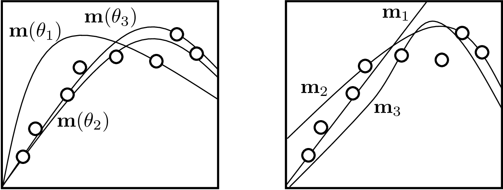
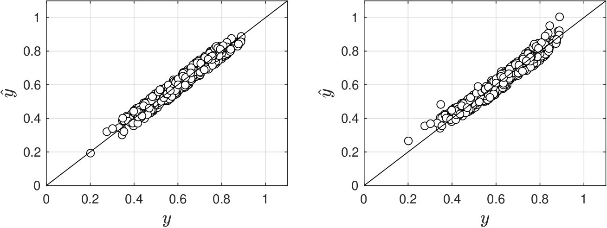
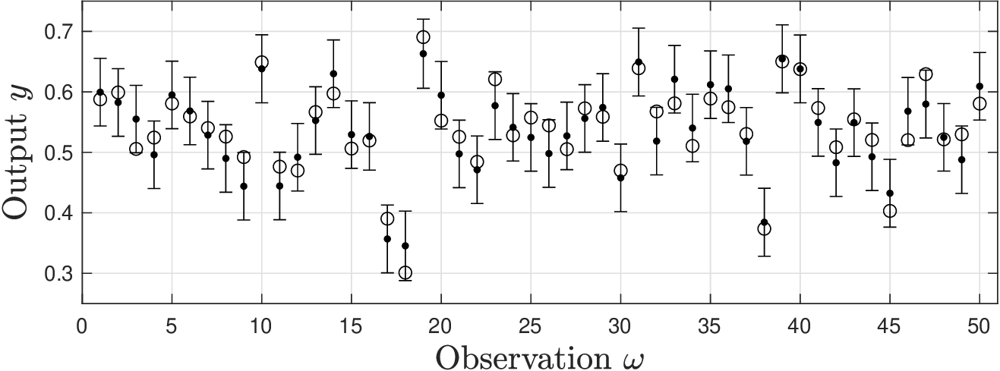
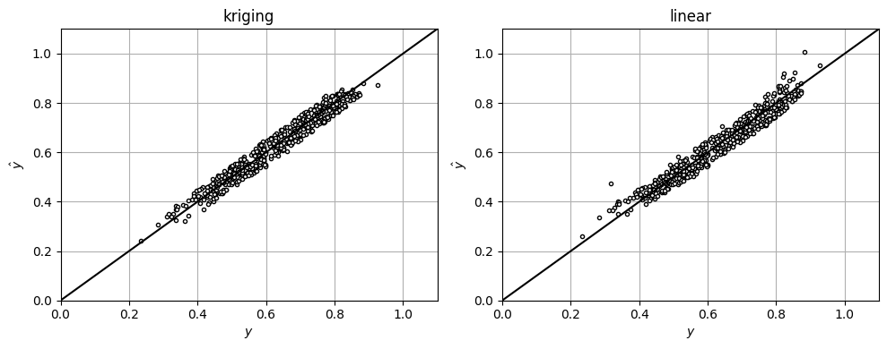
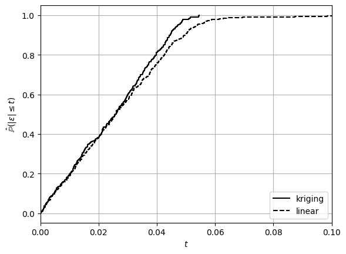
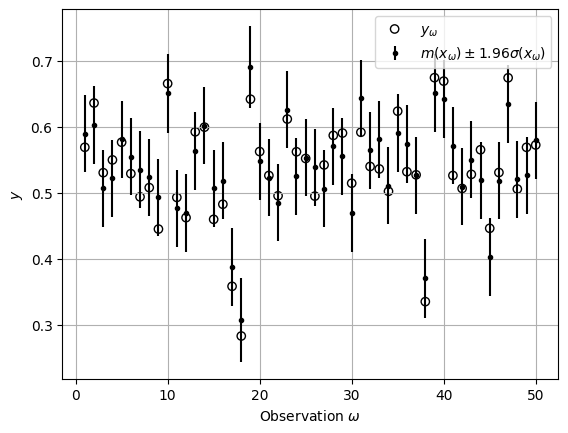
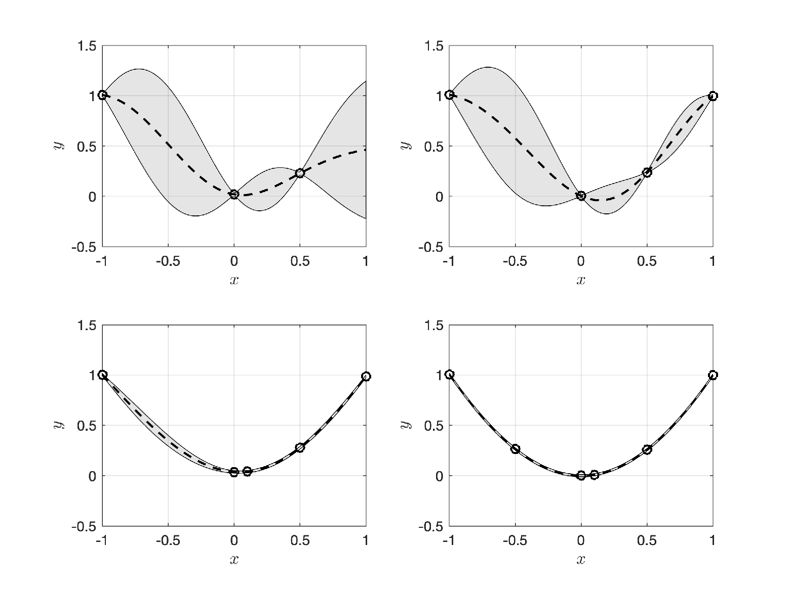
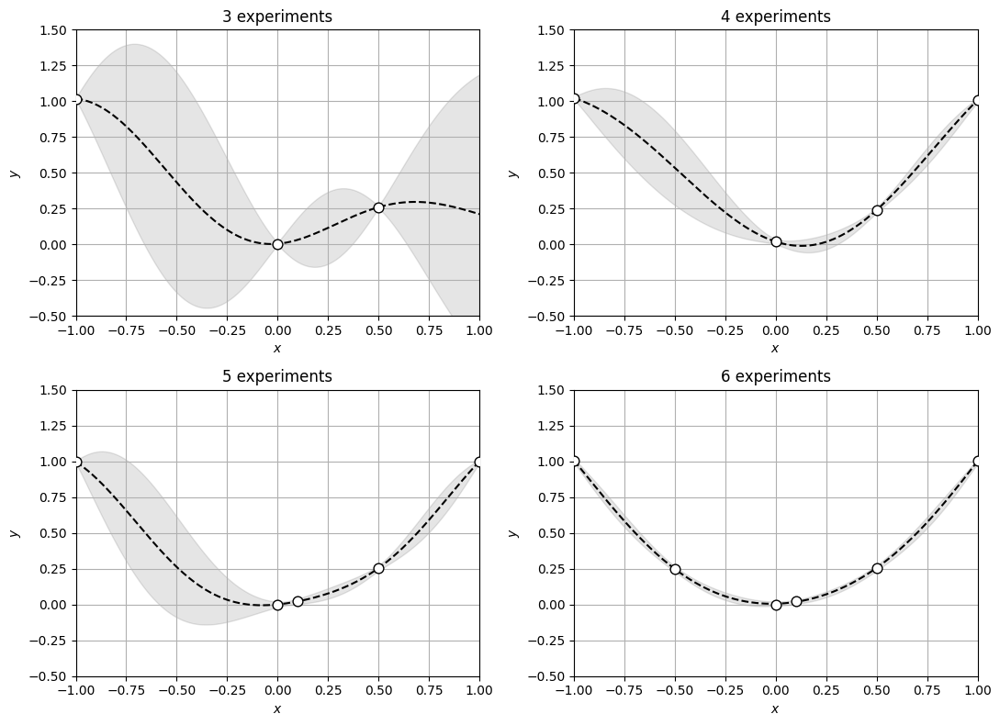

# Kriging

* Kriging (a.k.a. Gaussian process modeling) is a kernel modeling technique.
* In kriging, we postulate model of form:

  $$
  {y}_\omega = m(x_\omega)+\epsilon_\omega,\; \omega \in \mathcal{S}
  $$

* In vector form:

  $$
  \mathbf{y}= \mathbf{m}+\epsilon
  $$

* $$\mathbf{y}\in \mathbb{R}^S$$ contains obs $$y_\omega$$ and $$\mathbf{m}\in \mathbb{R}^{S}$$ contains model obs $$m(x_\omega)$$.
* In kriging we treat $$\mathbf{m}$$ as a random *function* that has no params.
* Motivated by fact that kernel methods do not require params $$\theta$$ to make predictions.
* This is key difference over parametric models $$\mathbf{m}(\theta,x_\omega)$$.

* Model $$\mathbf{m}$$ is assumed to be RV $$\mathcal{N}(0,\mathbf{K}(\gamma))$$.
* Here, $$\mathbf{K}(\gamma)=\textrm{Cov}(\mathbf{m})\in \mathbb{R}^{S\times S}$$ is model covariance and $$\gamma$$ are its params.
* $$\mathbf{K}(\gamma)$$ as a matrix function that generates samples of model $$\mathbf{m}$$.
* In parametric models we  generate alternatives by tuning parameters, kriging generates alternatives via sampling.

  <figure><figcaption><p>Generation of alternative models for parametric model 𝐦(θ) using θ (left). Generation of alternative models for GP using realizations of 𝐦 ∼ 𝒩(0, 𝐊(γ)) (right).</p></figcaption></figure>

* Covariance is a kernel matrix with entries:

  $$
  \mathbf{K}_{\omega,\omega'}(\gamma)=k(x_\omega,x_{\omega'},\gamma),\; \omega,\omega'\in \mathcal{S}
  $$

   where $$k(x_\omega,x_{\omega'},\gamma)$$ is kernel function.

* Joint pdf of $$\mathbf{y}$$ and $$\mathbf{m}$$ is given by:

  $$
  f(\mathbf{y},\mathbf{m}|\gamma)=f(\mathbf{y}|\mathbf{m},\gamma) f(\mathbf{m}|\gamma).
  $$

* Marginal pdf of $$\mathbf{y}$$ is:

  $$
  \begin{aligned}
  f(\mathbf{y}|\gamma)&=\int_{\mathbf{m}\in \mathcal{D}_{\mathbf{m}}}f(\mathbf{y}|\mathbf{m},\gamma)f(\mathbf{m}|\gamma)d\mathbf{m}
  \end{aligned}
  $$

* One can show that marginal pdf of $$\mathbf{y}$$ is $$\mathcal{N}(0,\mathbf{C}(\gamma))$$.
* Entries of covariance  matrix are:

  $$
  \mathbf{C}_{\omega,\omega'}(\gamma)=\mathbf{K}_{\omega,\omega'}(\gamma)+\sigma^2\cdot  \delta_{i,j},\quad \omega,\omega'\in \mathcal{S}.
  $$

   Here, $$\delta_{\omega,\omega'}=1$$ if $$x_\omega=x_{\omega'}$$ and zero otherwise.

* One can estimate $$\hat{\gamma}$$ by using MLE with likelihood $$f(\mathbf{y}|\gamma)$$:

  $$
  \max_\gamma \; -\frac{1}{2}\log|\mathbf{C}(\gamma)|-\frac{1}{2}\mathbf{y}^T\mathbf{C}(\gamma)\mathbf{y}-\frac{S}{2}\log 2\pi
  $$

* One needs to use advanced numerical solvers to tackle this problem.

* Kriging makes predictions using conditional pdf $$f(y|\mathbf{y},\gamma)$$.
* $$y$$ is predicted output at new point $$x$$ of interest.
* $$\mathbf{y}$$ are obs used to determine $$\hat{\gamma}$$ (obs used for training model).
* One can show that $$f(y|\mathbf{y},\gamma)$$ is Gaussian $$\mathcal{N}(m(x),\sigma^2(x))$$ with:

  $$
  \begin{aligned}
  m(x)&=\mathbf{k}(x,\hat{\gamma})^T\mathbf{C}(\hat{\gamma})^{-1}\mathbf{y}\\
  \sigma^2(x)&=c(x,\hat{\gamma})-\mathbf{k}(x,\hat{\gamma})^T\mathbf{C}(\hat{\gamma})\mathbf{k}(x,\hat{\gamma})
  \end{aligned}
  $$

   where:

  $$
  \begin{aligned}
  c(x,\hat{\gamma})&=k(x,x,\hat{\gamma})\\
  \mathbf{k}_\omega(x,\hat{\gamma})&=k(x_\omega,x,\hat{\gamma}),\; \omega=1,...,S
  \end{aligned}
  $$

* Mean prediction is $$\mathbb{E}[y]=m(x)$$ and variance is $$\mathbb{V}[y]=\sigma^2(x)$$.
* One use kriging to mix physics and data-driven models.
* Done by defining $$f(\mathbf{y}|\mathbf{m},\theta)$$ as $$\mathcal{N}(h(\mathbf{x},\theta)+\mathbf{m},\sigma \mathbf{I})$$ where $$h(\mathbf{x},\theta)$$ is physics model.

## Example: Kriging Model for Gibbs Reactor

* Compare prediction of kriging (nonlinear) model against that of linear model.
* Gather data for inputs $$X=(P,T)$$ and output (conversion) $$Y=C$$.
* Kriging model better captures nonlinearity.

  <figure><figcaption><p>Parity plots for kriging (left) and linear (right) models for Gibbs reactor.</p></figcaption></figure>

* Kriging provides uncertainty information for predictions (e.g., confidence intervals).

  <figure><figcaption><p>Observed outputs (white dots), mean outputs (black dots), and 95% confidence intervals.</p></figcaption></figure>

#### Python implementation


Notebook [`ch6_gibbs_kriging.ipynb`](https://colab.research.google.com/github/vzavala/StatsBook-GitBook/blob/main/notebooks/ch6_gibbs_kriging.ipynb) — open it in Colab and run the cells alongside this section.


Kriging (Gaussian process) model for the Gibbs reactor (Victor Z and Ugochukwu Ikegwu, UW-Madison, 2024).

| Slides | Python | Meaning |
|---|---|---|
| $$X=(P,T)$$, $$Y=C$$ | `X`, `y` | inputs (pressure, temperature) and conversion |
| $$k(x,x',\gamma)$$, $$\hat{\gamma}$$, $$\sigma^2$$ | `kernel`, `gp.kernel_` | Matern kernel plus noise term, and their MLE values |
| $$m(x)$$, $$\sigma(x)$$ | `m_x`, `sigma_x` | predictive mean and SD |
| $$\epsilon_\omega$$ | `eps_gp`, `eps_lin` | residuals of kriging and linear models |

```python
import numpy as np
import matplotlib.pyplot as plt
from sklearn.gaussian_process import GaussianProcessRegressor
from sklearn.gaussian_process.kernels import Matern, WhiteKernel
from sklearn.linear_model import LinearRegression

data = np.vstack((np.loadtxt(path+'Data/gibbs_hightemp_class.dat'),
                  np.loadtxt(path+'Data/gibbs_lowtemp_class.dat')))
S = len(data)
np.random.seed(1)
X = np.column_stack((data[:, 1], data[:, 0])) + np.random.rand(S, 2) * 0.1   # (P, T)
y = data[:, 2] + np.random.rand(S) * 0.1                                     # C
```

Fit $$\hat{\gamma}$$ by maximizing $$\log f(\mathbf{y}|\gamma)$$, then predict with
$$m(x)=\mathbf{k}(x)^T\mathbf{C}^{-1}\mathbf{y}$$ and $$\sigma^2(x)=c(x)-\mathbf{k}(x)^T\mathbf{C}^{-1}\mathbf{k}(x)$$.
A linear model is fitted for comparison.

```python
kernel = Matern(length_scale=1, nu=1.5) + WhiteKernel(noise_level=0.01)   # K(gamma) + sigma^2 I
gp = GaussianProcessRegressor(kernel=kernel, normalize_y=True, n_restarts_optimizer=10, random_state=0).fit(X, y)
m_x, sigma_x = gp.predict(X, return_std=True)            # sigma_x includes the noise term
lin = LinearRegression().fit(X, y)
eps_gp, eps_lin = y - m_x, y - lin.predict(X)
print("fitted kernel:", gp.kernel_)

fig, axs = plt.subplots(1, 2, figsize=(10, 4))
for ax, pred, title in ((axs[0], m_x, 'kriging'), (axs[1], lin.predict(X), 'linear')):
    ax.plot(y, pred, 'ko', markerfacecolor='w', markersize=3)
    ax.plot([0, 1.1], [0, 1.1], 'k-')
    ax.set_title(title); ax.set_xlabel('$y$'); ax.set_ylabel(r'$\hat{y}$')
    ax.axis([0, 1.1, 0, 1.1]); ax.grid(True)
plt.tight_layout()
plt.show()
```

```
fitted kernel: Matern(length_scale=97, nu=1.5) + WhiteKernel(noise_level=0.0462)
```

<figure></figure>

Compare the residuals through the empirical cdf of $$|\epsilon|$$.

```python
for eps, style, label in ((eps_gp, 'k-', 'kriging'), (eps_lin, 'k--', 'linear')):
    e = np.sort(np.abs(eps))
    plt.step(e, np.arange(1, S + 1) / S, style, where='post', label=label)
plt.xlim(0, 0.1)
plt.xlabel('$t$'); plt.ylabel(r'$\hat{\mathbb{P}}(|\epsilon|\leq t)$')
plt.legend(loc='lower right'); plt.grid(True)
plt.show()
```

<figure></figure>

95% confidence intervals $$m(x_\omega)\pm 1.96\,\sigma(x_\omega)$$ for the first 50 observations.

```python
w = np.arange(1, 51)
plt.errorbar(w, m_x[:50], yerr=1.96 * sigma_x[:50], fmt='k.', markersize=6, label=r'$m(x_\omega)\pm1.96\sigma(x_\omega)$')
plt.scatter(w, y[:50], color='black', facecolors='none', label=r'$y_\omega$')
plt.xlabel(r'Observation $\omega$'); plt.ylabel('$y$')
plt.legend(); plt.grid(True)
plt.show()
```

<figure></figure>

## Example: Experimental Design using GP Models

* In this example we illustrate how the uncertainty quantification capabilities of GP can be used to guide the collection of experiments.
* Imagine that you have a system in which you can manipulate an input $$x$$ (e.g., temperature) to optimize the performance of an output $$y$$ (e.g., cost).
* You start with 3 experimental data points that you use to train your GP. Note how the model prediction has no uncertainty at the location of the experimental points, but it has significant uncertainty in the unexplored regions of the input.
* Note how the uncertainty information provides guidance on where to sample next and provide an indication when the model has been approximated well.

<figure><figcaption><p>Evolution of model prediction uncertainty for GP with 3 data points (top-left), 4 data points (top-right), 5 data points (bottom-left) and 6 data points (bottom-right).</p></figcaption></figure>

#### Python implementation


Notebook [`ch6_kriging_uq.ipynb`](https://colab.research.google.com/github/vzavala/StatsBook-GitBook/blob/main/notebooks/ch6_kriging_uq.ipynb) — open it in Colab and run the cells alongside this section.


Using the GP uncertainty to choose experiments (Victor Z, UW-Madison, 2024). The true response is
$$y=x^2$$ (plus small noise). With 3, 4, 5, and 6 experiments $$(x_\omega,y_\omega)$$ (`x_omega`, `y_omega`)
we plot the mean $$m(x)$$ and the band $$m(x)\pm1.96\,\sigma(x)$$; uncertainty is zero at the
experiments and large far from them, which tells us where to sample next.

```python
import numpy as np
import matplotlib.pyplot as plt
from sklearn.gaussian_process import GaussianProcessRegressor
from sklearn.gaussian_process.kernels import RBF, ConstantKernel

np.random.seed(0)
x = np.linspace(-1, 1, 400).reshape(-1, 1)
designs = [[-1, 0, 0.5], [-1, 0, 0.5, 1], [-1, 0, 0.5, 1, 0.1], [-1, 0, 0.5, 1, 0.1, -0.5]]

fig, axs = plt.subplots(2, 2, figsize=(11, 8))
for ax, design in zip(axs.ravel(), designs):
    x_omega = np.array(design).reshape(-1, 1)
    y_omega = x_omega.ravel()**2 + 0.01 * np.random.randn(len(design))
    kernel = ConstantKernel(1.0, (1e-4, 1e1)) * RBF(1, (1e-4, 1e1))
    gp = GaussianProcessRegressor(kernel=kernel, n_restarts_optimizer=10, alpha=0.01**2, random_state=0)
    gp.fit(x_omega, y_omega)
    m_x, sigma_x = gp.predict(x, return_std=True)
    ax.fill_between(x.ravel(), m_x - 1.96*sigma_x, m_x + 1.96*sigma_x, color='k', alpha=0.1)
    ax.plot(x, m_x, '--k', linewidth=1.5)
    ax.scatter(x_omega, y_omega, edgecolor='black', facecolor='white', s=60, zorder=3)
    ax.set_title(f'{len(design)} experiments')
    ax.set_xlim(-1, 1); ax.set_ylim(-0.5, 1.5)
    ax.set_xlabel('$x$'); ax.set_ylabel('$y$')
    ax.grid(True)
plt.tight_layout()
plt.show()
```

<figure></figure>
