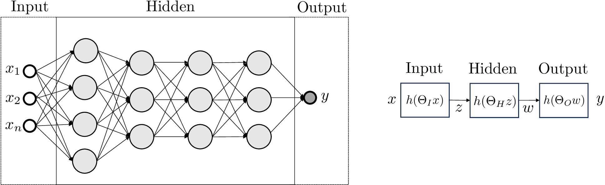
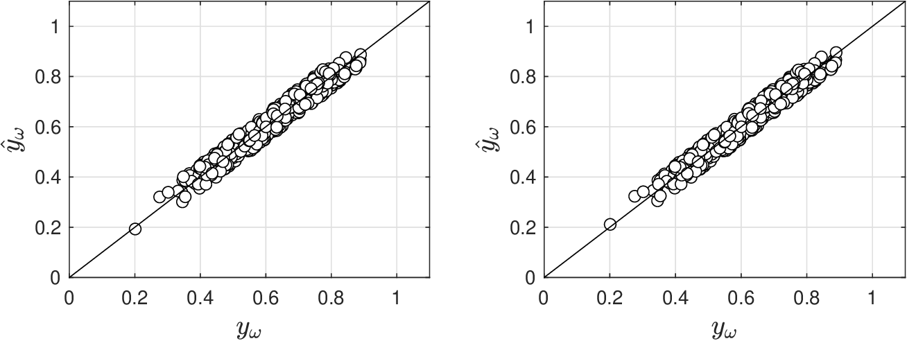
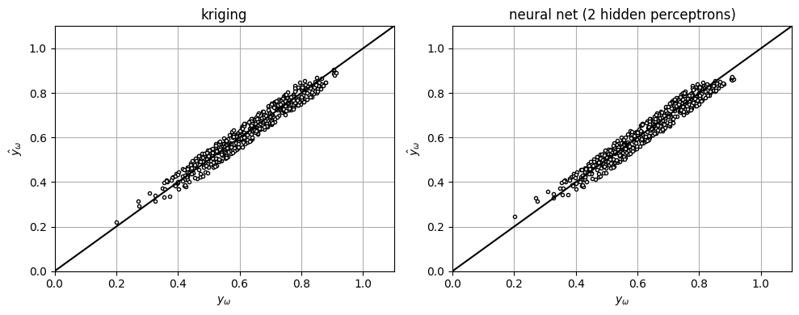
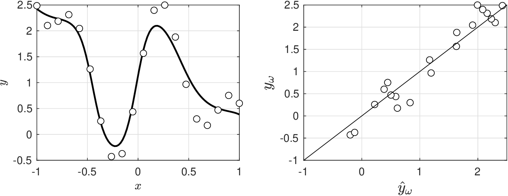
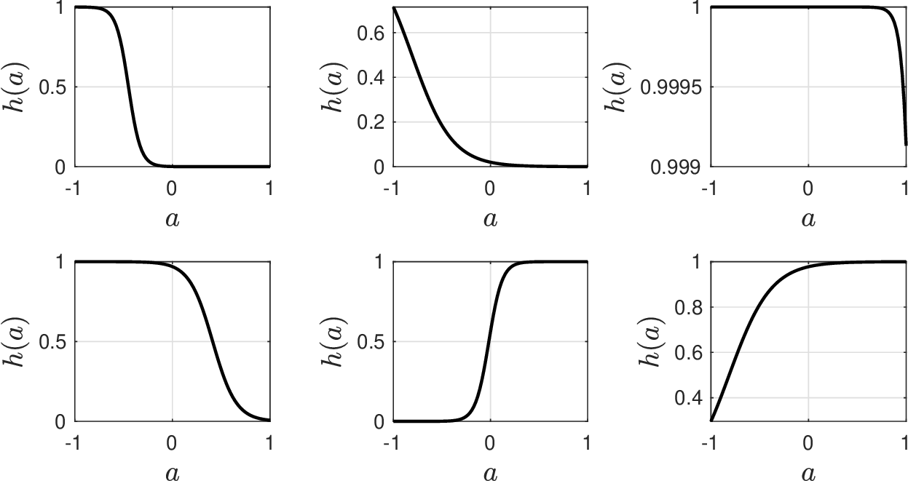
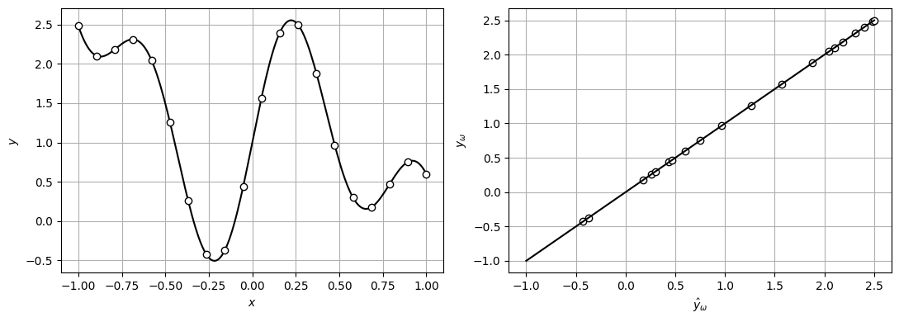
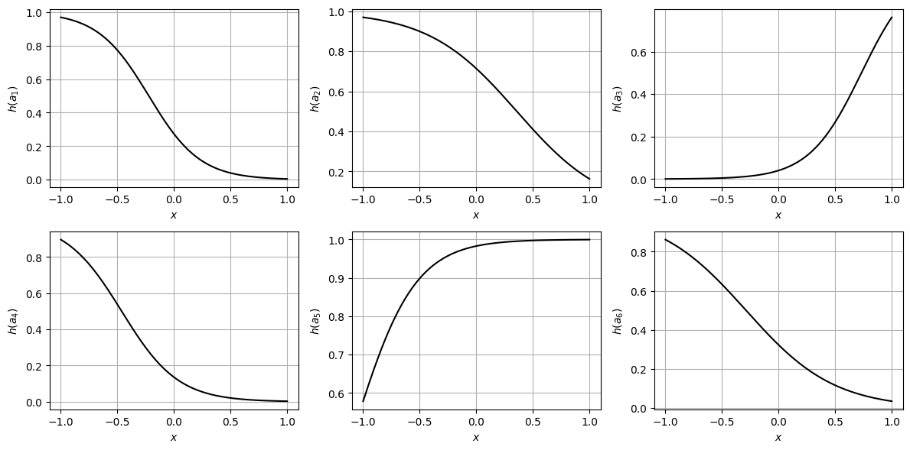

# Neural Nets

* Explore powerful set of predictive models known as neural networks (NNs).
* Development motivated by following questions:
   * How do humans learn from observations?
   * How do humans establish connections between variables to make predictions?
* NNS are most general form of *parametric* models that currently exist.
* NNs mimic how brain (a network of neurons) learns from obs (data from senses).
* NNs are universal; they can capture virtually any relationship between variables.
* Flexibility helps explains why humans are remarkably good at learning.
* On the other hand, flex comes at expense of requiring an enormous number of params; one has to verify that NNs generalize well  (predict outside domain of obs).

## Fully Connected Neural Nets

* Fully connected NNs are parametric models of form:

  $$
  Y=g(X,\theta)+\epsilon.
  $$

* Model $$m(X,\theta)$$ is built by using basis functions that are mixed *hierarchically*.
* Combinations of basis functions are captured by $$\theta$$.
* Hierarchical structure mimics brain; the deeper the hierarchy, the more complexity.
* Goal is to train NN model to fit obss:

  $$
  y_\omega=m(x_\omega,\theta)+\epsilon_\omega,\; \omega \in \mathcal{S}
  $$

* Determination of $$\theta$$ from data mimics human *learning* process.
* Specifically, NNs mimic how brain responds when exposed to data.

* Neurons as processing units of brain that interact with one another through signals.
* Math description of a neuron is called a *perceptron*.
* Perceptron generates signal if evidence $$\theta^Tx=\sum_{i=1}^n\theta_ix_i+\theta_0$$ is strong enough.
* Here, $$x_i$$ are inputs with weights $$\theta_i$$ and param $$\theta_0$$ is *bias*.
* Response of perceptron to evidence is modeled using binary logic:

  $$
  \begin{aligned}
  a=\left\{\begin{array}{cc}1\; &\; \theta^Tx \geq \tau \\ 0 \;  & \; \theta^Tx< \tau\end{array}\right.
  \end{aligned}
  $$

* Perceptron is unit that decides to activate or not when exposed to evidence.
* How to respond to different pieces of evidence is captured by params $$\theta$$.
* Binary behavior is modeled using a logistic function:

  $$
  a=\frac{1}{1+e^{-\theta^Tx}}.
  $$

* There are different types of activation functions.

* NN mixes perceptron signals to construct *complex logic*.
* NN architecture consists of: input layer, hidden layers, and output layer:
   * Input layer contains perceptrons that take input data $$x_\omega,\; \omega \in \mathcal{S}$$ to generate signals. This captures basic logic (i.e., I predicted this because of that).
   * Hidden layers contain perceptrons that take signals from input layer to generate additional signals (captures complex logic).
   * Output layer contains perceptrons that take signals from hidden layer to generate final output signal $$y_\omega, \, \omega \in \mathcal{S}$$.
* Output signal can be continuous (regression) or discrete (classification).
* We now show how to train NNs; we consider architecture with one hidden layer.

<figure><figcaption><p>Sketch of hierarchical structure of a neural network (left). Simplified visualization showing sequential transformations of data (right).</p></figcaption></figure>

* *Input layer* is composed of $$j=1,...,n_I$$ perceptrons. Evidence in perceptron $$j$$ is :

  $$
  a_j=\sum_{i=1}^n\theta_{j,i}^{I}x_i+\theta_{j,0}^I
  $$

   Given evidence, perceptron $$j$$ generates the signal:

  $$
  z_j=h(a_j)
  $$

   where $$h(a_j)$$ is known as the activation function.

* *Hidden layer* is composed of $$k=1,...,n_H$$ perceptrons. Evidence in perceptron $$k$$ is:

  $$
  a_k=\sum_{j=1}^{n_I}\theta_{k,j}^{H}z_j+\theta_{k,0}^H.
  $$

   Given evidence, perceptron $$k$$ generates the signal:

  $$
  w_k=h(a_k)
  $$

* *Output layer* takes signals of hidden layer as evidence:

  $$
  a=\sum_{k=1}^{n_H}\theta_{k}^{O}w_k+\theta_{0}^O
  $$

   Final output is $$m=\sigma(a)$$.

* The propagation of the input $$x$$ through the layers to obtain the output as a nested, *forward proagation* mapping:

  $$
  \begin{aligned}
  \hat{y}&=h\left(\Theta_O h\left(\Theta_H h(\Theta_I x)\right)\right)\\
  &=m(\theta,x),
  \end{aligned}
  $$

   where $$\theta=(\Theta_I,\Theta_H,\Theta_O)\in \mathbb{R}^p$$ contains all the parameters of the NN.

* Use MLE to estimate $$\theta$$. For regression problems we solve:

  $$
  \min_{\theta}\; L(\theta)=\frac{1}{2}\sum_{\omega\in \mathcal{S}}(y_\omega - m_\omega(\theta))^2+\kappa\,\rho(\theta).
  $$

* For classification, one uses the log loss (as in logistic classification).

* To solve problem, it is necessary to compute derivatives of loss function with respect to the parameters  $$\nabla_\theta L(\theta)$$.
* These derivatives are computed by using a technique called *back propagation*.
* This technique marches in backward direction across NN (from output to input).
* Derivative information is used to progressively refine parameter estimates; typically using a family of algorithms known as gradient descent.
* In gradient descent algorithm, parameters are updated as:

  $$
  \theta_{\ell+1}=\theta_{\ell} - \kappa \nabla_\theta L(\theta_\ell)
  $$

* Newton's method is not used in NNs (e.g., Hessian is difficult to compute).

* NN params have no physical meaning (difficult to convey prior knowledge).
* Limitation manifests as need for large amounts of data to determine params which are also many (on the order of thousands to millions). In arch discussed, we have $$n=n_I\cdot n+n_H\cdot n_I+n_H$$ params.
* A typical issue with NNs is that of *overfitting*.  Regularization (e.g., $$\rho(\theta)=\lambda \theta^T\theta$$) are often added to loss function.
* Uncertainty of estimated parameters increases with number of params.
* Because overfitting and high uncertainty are important issues, conducting cross-validation is critical.
* Hessian matrix $$\nabla_\theta^2 L(\theta_\ell)$$ is impossible to compute in many apps.
* One can mix physics and NNs by using models $$Y=m(X,\theta)+NN(X,\theta)$$.

## Example: Neural Net Model for Gibbs Reactor

* We now compare performance of NN against kriging models.
* NN model is simple, contains one hidden layer with two perceptrons.
* NN fits data well; can capture high nonlinearity.
* Fact that this can be done with one hidden layer is remarkable.

  <figure><figcaption><p>Fit of kriging (left) and NN (right) models for Gibbs model.</p></figcaption></figure>

#### Python implementation


Notebook [`ch6_gibbs_neuralnet.ipynb`](https://colab.research.google.com/github/vzavala/StatsBook-GitBook/blob/main/notebooks/ch6_gibbs_neuralnet.ipynb) — open it in Colab and run the cells alongside this section.


Neural net versus kriging for the Gibbs reactor (Victor Z and Ugochukwu Ikegwu, UW-Madison, 2024).
Inputs $$x_\omega=(P,T)$$ (`X`, scaled), output conversion $$y_\omega$$ (`y`). The NN has one hidden layer
with two perceptrons (logistic activations) and is trained by minimizing the squared loss $$L(\theta)$$.

```python
import numpy as np
import matplotlib.pyplot as plt
from sklearn.neural_network import MLPRegressor
from sklearn.gaussian_process import GaussianProcessRegressor
from sklearn.gaussian_process.kernels import Matern, WhiteKernel
from sklearn.preprocessing import StandardScaler

data = np.vstack((np.loadtxt(path+'Data/gibbs_hightemp_class.dat'),
                  np.loadtxt(path+'Data/gibbs_lowtemp_class.dat')))
S = len(data)
np.random.seed(0)
X = np.column_stack((data[:, 1], data[:, 0])) + np.random.rand(S, 2) * 0.1   # (P, T)
y = data[:, 2] + np.random.rand(S) * 0.1
X = StandardScaler().fit_transform(X)

nn = MLPRegressor(hidden_layer_sizes=(2,), activation='logistic', solver='lbfgs',
                  max_iter=20000, random_state=2024).fit(X, y)
y_nn = nn.predict(X)
gp = GaussianProcessRegressor(kernel=Matern(length_scale=1, nu=1.5) + WhiteKernel(0.01), normalize_y=True,
                              n_restarts_optimizer=5, random_state=0).fit(X, y)
y_gp = gp.predict(X)
n_params = sum(w.size for w in nn.coefs_) + sum(b.size for b in nn.intercepts_)
print(f"NN parameters: {n_params};  MSE NN = {np.mean((y - y_nn)**2):.2e},  MSE kriging = {np.mean((y - y_gp)**2):.2e}")

fig, axs = plt.subplots(1, 2, figsize=(10, 4))
for ax, pred, title in ((axs[0], y_gp, 'kriging'), (axs[1], y_nn, 'neural net (2 hidden perceptrons)')):
    ax.plot(y, pred, 'ko', markerfacecolor='w', markersize=3)
    ax.plot([0, 1.1], [0, 1.1], 'k-')
    ax.set_title(title); ax.set_xlabel(r'$y_\omega$'); ax.set_ylabel(r'$\hat{y}_\omega$')
    ax.axis([0, 1.1, 0, 1.1]); ax.grid(True)
plt.tight_layout()
plt.show()
```

```
NN parameters: 9;  MSE NN = 9.29e-04,  MSE kriging = 8.71e-04
```

<figure></figure>

## Example: Perceptrons as Basis Functions

* Why are NNs so effective at capturing such behavior?
* NNs are sophisticated basis function models (activation funcs are basis funcs).
* To see this, construct simple NN with $$N$$ perceptrons:

  $$
  h_j(a)=\frac{1}{1+e^{-a_j}},\; k=1,...,N
  $$

   where $$a_j=\theta_{j,1}^I\cdot x + \theta_{j,0}^I$$  (NN only has one input).

* NN output is $$\hat{y}=\sum_{j=1}^{n_I}\theta_j^O h(a_j)$$ (there are no hidden layers).
* NN model has a total of 18 params.

* Fitx of NN model to function $$y=\sin(4x)+\sin(8x)+\exp(-x)$$ is excellent.
* Here we show the sigmoidal functions (basis functions) of the NN model.
* Hessian reveals that several eigenvalues are close to zero.
* NN model is highly flexible but data is overfit.

  <figure><figcaption><p>Fit of NN model to data (left) and parity plot (right).</p></figcaption></figure>

<figure><figcaption><p>Sigmoidal functions of NN model for example model.</p></figcaption></figure>

#### Python implementation


Notebook [`ch6_neuralnet_basis.ipynb`](https://colab.research.google.com/github/vzavala/StatsBook-GitBook/blob/main/notebooks/ch6_neuralnet_basis.ipynb) — open it in Colab and run the cells alongside this section.


Perceptrons as basis functions (Victor Z and Ugochukwu Ikegwu, UW-Madison, 2024).

| Slides | Python | Meaning |
|---|---|---|
| $$a_j=\theta^I_{j,1}x+\theta^I_{j,0}$$ | `theta_I1[j] * x + theta_I0[j]` | evidence of perceptron $$j$$ |
| $$h_j(a)=1/(1+e^{-a_j})$$ | `h(a)` | sigmoidal activation (basis function) |
| $$\hat{y}=\sum_j\theta^O_jh(a_j)$$ | `m(theta, x)` | NN output |
| $$\theta=(\theta^I_{\cdot,1},\theta^O,\theta^I_{\cdot,0})$$ | `theta` | the 18 parameters ($$N=6$$ perceptrons) |
| $$\mathcal{H}\approx\mathcal{J}^T\mathcal{J}$$ | `H` | Gauss-Newton Hessian |

```python
import numpy as np
import matplotlib.pyplot as plt
from scipy.optimize import least_squares

N = 6                                            # perceptrons
x = np.linspace(-1, 1, 20)
y = np.sin(4*x) + np.sin(8*x) + np.exp(-x)

def h(a):
    return 1 / (1 + np.exp(-a))

def unpack(theta):
    return theta[:N], theta[N:2*N], theta[2*N:]  # theta_I1, theta_O, theta_I0

def m(theta, x):
    theta_I1, theta_O, theta_I0 = unpack(theta)
    return sum(theta_O[j] * h(theta_I1[j] * x + theta_I0[j]) for j in range(N))

sol = least_squares(lambda th: m(th, x) - y, np.ones(3 * N), method='trf', max_nfev=5000)
theta = sol.x
print(f"number of parameters = {theta.size}")

x_fine = np.linspace(-1, 1, 200)
fig, axs = plt.subplots(1, 2, figsize=(11, 4))
axs[0].plot(x_fine, m(theta, x_fine), 'k', linewidth=1.5)
axs[0].plot(x, y, 'ko', markerfacecolor='w')
axs[0].set_xlabel('$x$'); axs[0].set_ylabel('$y$')
axs[1].plot(m(theta, x), y, 'ko', markerfacecolor='w')
axs[1].plot([-1, 2.5], [-1, 2.5], 'k')
axs[1].set_xlabel(r'$\hat{y}_\omega$'); axs[1].set_ylabel(r'$y_\omega$')
for ax in axs:
    ax.grid(True)
plt.tight_layout()
plt.show()
```

```
number of parameters = 18
```

<figure></figure>

The sigmoids $$h(a_j)$$ are the basis functions mixed by the output layer:

```python
theta_I1, theta_O, theta_I0 = unpack(theta)
fig, axs = plt.subplots(2, 3, figsize=(12, 6))
for j, ax in enumerate(axs.ravel()):
    ax.plot(x_fine, h(theta_I1[j] * x_fine + theta_I0[j]), 'k', linewidth=1.5)
    ax.set_xlabel('$x$'); ax.set_ylabel(rf'$h(a_{j+1})$')
    ax.grid(True)
plt.tight_layout()
plt.show()
```

<figure></figure>

Several eigenvalues of the Gauss-Newton Hessian are close to zero: the model is very flexible
and the 20 data points are overfit.

```python
H = sol.jac.T @ sol.jac
print("eigenvalues of H:", np.array2string(np.sort(np.linalg.eigvalsh(H))[::-1], precision=2))
```

```
eigenvalues of H: [ 3.72e+05  9.16e+04  9.44e+03  1.44e+03  2.43e+02  2.52e+01  1.26e+01
  2.52e+00  1.69e-01  2.92e-02  2.85e-03  6.14e-04  9.31e-06  9.99e-08
  5.18e-10  8.94e-13  1.46e-13 -1.25e-15]
```
