# Convolutional Neural Nets

* CNNs are NNs that specialized to take structured data as inputs in form of  vectors $$\mathbf{x}_\omega$$ (for 1D) or matrices $$\mathbf{X}_\omega$$ (for 2D) to make predictions $$y_\omega$$.
* Input data vectors can be a sequence of numbers that encode a certain pattern and matrices can be images or other objects containing spatial patterns.
* e.g., can train a CNN to predict temp of a furnace from a picture of an infrared camera or to predict a property of a molecule from its sequence of atoms.
* CNNs can be generalized to process data that includes color images and can process 3D data in the form of tensors.
* CNNs extract knowledge from data in form of patterns (features).
* CNNs extract features by using filters (2D filter is matrix $$\Theta_k$$ that encodes pattern).

* Extracted features are used as evidence to generate activation signals.
* Process mimics how brain makes predictions based on patterns.
* Filter matrices and params of evidence are learned simultaneously from data.
* CNNs can learn what are best filters to extract from data to make predictions (not necessary for us to specify filters).
* Components of a CNN arch are: input layer, hidden layers, and fully connected layer.
* input and hidden layers seek to extract features from the input matrices.
* Features are passed to the fully connected layer to make a final prediction.

<figure>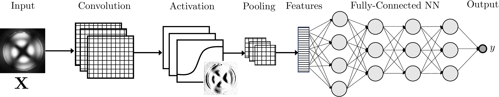<figcaption><p>Sketch of a convolutional neural network architecture.</p></figcaption></figure>

* *Input layer* is composed of $$j=1,...,n_I$$ perceptrons. Each unit performs convolution, activation, and pooling. Evidence in unit $$j$$ is :

  $$
  \mathbf{A}_j=\mathbf{X}*\Theta_{j}^{I}+\theta_j^I
  $$

   Here, $$\Theta_{j}^I$$ is param of perceptron (its filter). Matrix $$\mathbf{X}$$ is input data (e.g., image).

* Layer contains $$n_I$$ filters. Filter matrices are small ($$3\times 3$$, $$5\times 5$$ or $$7\times 7$$).
* Convolution generates evidence $$\mathbf{E}_j$$ (matrix). Evidence is activated to produce signal:

  $$
  \mathbf{Z}_j=h(\mathbf{A}_j)
  $$

   where $$h(\mathbf{A}_j)$$ is activation function; $$\mathbf{Z}_j$$ is activation matrix.

* Activation matrices $$\mathbf{Z}_j$$ are reduced in size by using pooling:

  $$
  \bar{\mathbf{Z}}_j=p(\mathbf{Z}_j)
  $$

   where $$p(\mathbf{Z}_j)$$ is pooling function and $$\bar{\mathbf{Z}}_j$$ is pooled matrix.

* *Hidden layer* is composed of $$k=1,...,n_H$$ perceptrons (we use single layer).
* Evidence in perceptron $$k$$ is:

  $$
  \mathbf{A}_k=\sum_{j=1}^{n_I}\Theta_{k,j}^{H}*\bar{\mathbf{Z}}_j+\theta_{k}^H.
  $$

   Given evidence, signal generated is:

  $$
  \mathbf{W}_k=h(\mathbf{A}_k)
  $$

   and this is reduced by using pooling as $$\bar{\mathbf{W}}_k=p(\mathbf{W}_k)$$.

* Matrices $$\bar{\mathbf{W}}_k$$ are converted to vectors $$\mathbf{w}_k$$ and stacked into feature vector $$\mathbf{w}=(\mathbf{w}_1,...,\mathbf{w}_{n_H})$$.
* We summarize convolutions, activation, and pooling in input and hidden layers:

  $$
  \mathbf{w}=f(\mathbf{X},\Theta,\theta)
  $$

   Where $$\Theta$$ contains filters of all convolutional layers and $$\theta$$ contains all biases.

* *Fully connected layer* takes feature vector $$\mathbf{w}$$ and maps this to final output.
* NN contains it own inlet, hidden, and output layers.
* Mapping of the NN from the feature vector $$\mathbf{w}$$ to the output is summarized as:

  $$
  \hat{y}=NN(\mathbf{w},\gamma)
  $$

   where $$\gamma$$ are parameters of the NN input, hidden, and output layers.

* Given params for all layers $$\beta=(\Theta,\theta,\gamma)$$; CNN propagates input $$\mathbf{X}_\omega$$ to predict $$\hat{y}=m_{\omega}(\beta)$$.
* Use MLE to estimate $$\beta$$. For regression:

  $$
  \min_{\beta}\; L(\beta)=\frac{1}{2}\sum_{\omega\in \mathcal{S}}(y_\omega - m_\omega(\beta))^2+\kappa\rho(\beta)
  $$

* A gradient descent algorithm uses derivative info to learn parameters.

* CNNs are conceptually similar to NNs; the key difference is that CNNs preprocess the input data to extract features prior to making a prediction.
* CNNs often have a large number of parameters; this is particularly evident from the fact that the parameters are matrices (the filter matrices).
* As such, CNNs are prone to *overfitting* and conducting cross-validation is also critical to make sure that the model generalizes well (to inputs not used for training).
* CNNs can take input objects that have multiple channels.  For example, a color image contains red, blue, and green (RGB) channels.
* 1D CNNs can be used to process sequences (such as time series). 3D CNNs can process tensors (medical images and video).
* After training the CNN, one can analyze the filter matrices ($$\Theta$$) to determine what patterns they are searching for in the images.
* Techniques such as Fourier transforms are used to accelerate computations. In many cases it is also necessary to use parallel computing to accelerate training process.

## Example: Classification of Flow Cytometry

* Endotoxins generated from bacteria can be detected by using solution that contains small droplets that are filled with a liquid crystal.
* Endotoxin binds to surface of droplet and generates perceptible change in configuration of liquid crystal inside droplets.
* Change in config can be measured using a flow cytometer; thousands of droplets are passed through cytometer and generates a light scatter field.
* Shape of scatter field changes with concentration and type of endotoxin.
* Train CNNs to automatically analyze scatter data to detect presence of endotoxin and to determine  bacterial species that endotoxin is associated with.
* We train CNN to classify presence (or not) of endotoxin; to do so, we collect 98 observations (49 with no endotoxin present and 49 with endotoxin present).

<figure>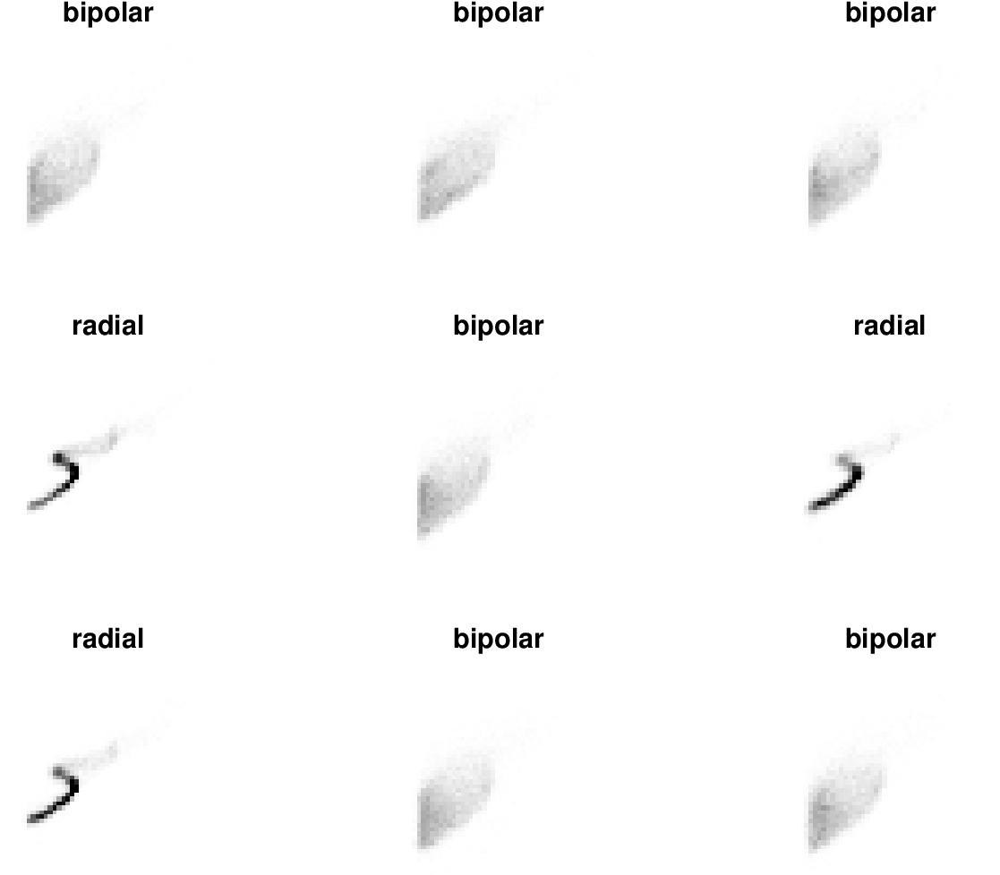<figcaption><p>Example observations for light scatter fields for contaminated and clean solutions.</p></figcaption></figure>

* We train CNN with single hidden layer that contains 3x3 filter (this is simple CNN).
* We use an ReLU function to activate convolved images.
* Confusion matrix shows that CNN perfectly classifies scatter fields (100% accuracy).
* Spatial pattern of scatter fields contains significant information to tell them apart.

  <figure>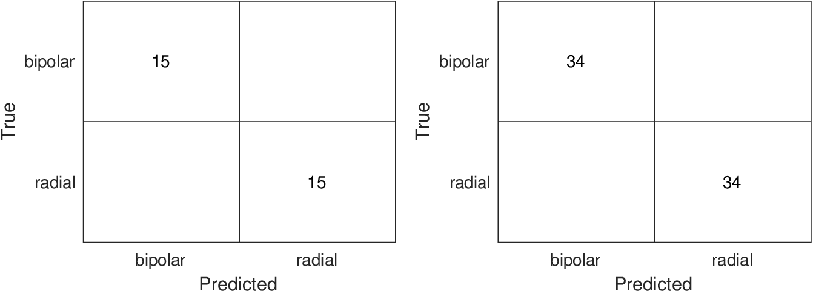<figcaption><p>Confusion matrix for training set (left) and validation set (right).</p></figcaption></figure>

* Upon inspection,  we find that filter matrix is of form:

  $$
  \Theta=\left[\begin{array}{ccc}
  -75.0392 & -73.0502  &-74.4749\\
  -91.4429 & -79.6735 & -61.1360\\
  -89.0361 & -62.3274  &-38.6508
  \end{array}\right]
  $$

* Filter does not have a structure that we are familiar with (e.g., Sobel or Gaussian).
* To determine what filter is doing, we visualize activated images.
* CNN filter highlights shape of scatter field.

  <figure>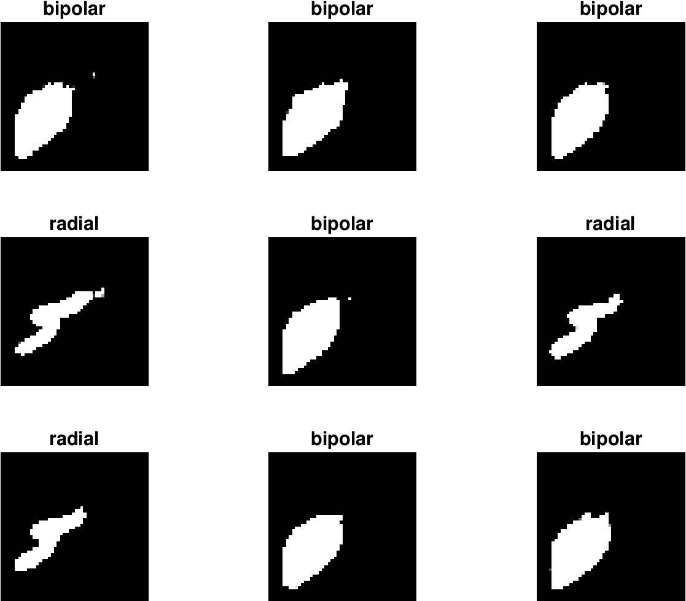<figcaption><p>Activations of images shown in Figure above using CNN filter.</p></figcaption></figure>

#### Python implementation


Notebook [`ch6_cnn_endotoxins_caseI.ipynb`](https://colab.research.google.com/github/vzavala/StatsBook-GitBook/blob/main/notebooks/ch6_cnn_endotoxins_caseI.ipynb) — open it in Colab and run the cells alongside this section.


CNN classification of flow-cytometry scatter fields: is endotoxin present? (Python version of
`ch6_cnn_endotoxins_caseI.m`, Victor Z, UW-Madison, 2020; uses PyTorch.)

| Slides | Python | Meaning |
|---|---|---|
| $$\mathbf{X}_\omega$$ | `X[w, 0]` | $$50\times 50$$ grayscale scatter field |
| $$y_\omega$$ | `y` | class: `bipolar` (no endotoxin) or `radial` (endotoxin) |
| $$\Theta^I$$, $$\theta^I$$ | `cnn[0].weight`, `cnn[0].bias` | $$3\times 3$$ filter and bias of the convolutional layer |
| $$\mathbf{A}=\mathbf{X}*\Theta^I+\theta^I$$, $$\mathbf{Z}=h(\mathbf{A})$$ | `cnn[0]`, `cnn[1]` | evidence and ReLU activation |
| $$NN(\mathbf{w},\gamma)$$ | `cnn[3]` | fully connected layer (2 classes, softmax) |
| $$L(\beta)$$ | `loss_fn` | cross-entropy (log) loss |

As in the Matlab script: one $$3\times 3$$ filter with "same" padding, ReLU, a fully connected
layer, 15 training images per class, the rest for validation, 40 epochs of SGD with momentum.

```python
import glob
import os
import numpy as np
import matplotlib.pyplot as plt
import torch
import torch.nn as nn
from skimage import io
from sklearn.metrics import confusion_matrix

folder = path + 'Data/Endotoxins_CaseI/Gray'
classes = sorted(os.listdir(folder))
X, y = [], []
for c, name in enumerate(classes):
    for f in sorted(glob.glob(f'{folder}/{name}/*.png')):
        X.append(io.imread(f).astype(np.float32) / 255)
        y.append(c)
X, y = np.array(X)[:, None], np.array(y)
print("classes:", classes, " images per class:", np.bincount(y), " image size:", X.shape[2:])

rng = np.random.default_rng(0)
train = np.concatenate([rng.choice(np.where(y == c)[0], 15, replace=False) for c in range(len(classes))])
valid = np.setdiff1d(np.arange(len(y)), train)
X_t = torch.tensor(X - X[train].mean(axis=0, keepdims=True))      # zero-center (as Matlab's input layer)
y_t = torch.tensor(y)
```

```
classes: ['bipolar', 'radial']  images per class: [49 49]  image size: (50, 50)
```

```python
torch.manual_seed(0)
cnn = nn.Sequential(nn.Conv2d(1, 1, kernel_size=3, padding=1),   # A = X * Theta + theta
                    nn.ReLU(),                                     # Z = h(A)
                    nn.Flatten(),                                  # feature vector w
                    nn.Linear(50 * 50, len(classes)))              # fully connected layer
loss_fn = nn.CrossEntropyLoss()
optimizer = torch.optim.SGD(cnn.parameters(), lr=0.01, momentum=0.9)

history = []
for epoch in range(40):
    perm = torch.tensor(train)[torch.randperm(len(train))]
    for b in range(0, len(perm), 10):
        idx = perm[b:b + 10]
        optimizer.zero_grad()
        loss = loss_fn(cnn(X_t[idx]), y_t[idx])
        loss.backward()
        optimizer.step()
    with torch.no_grad():
        acc = [(cnn(X_t[ids]).argmax(1) == y_t[ids]).float().mean().item() for ids in (train, valid)]
    history.append(acc)

history = np.array(history)
plt.plot(history[:, 0], 'k-', label='training'); plt.plot(history[:, 1], 'k--', label='validation')
plt.xlabel('epoch'); plt.ylabel('accuracy'); plt.legend(); plt.grid(True)
plt.show()
print(f"training accuracy = {history[-1, 0]:.0%},  validation accuracy = {history[-1, 1]:.0%}")
```

<figure>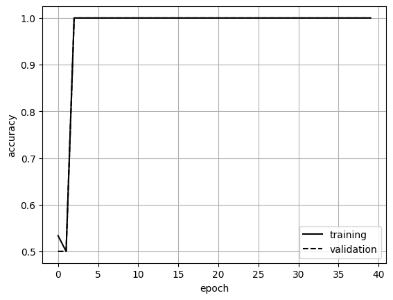</figure>

```
training accuracy = 100%,  validation accuracy = 100%
```

```python
with torch.no_grad():
    y_hat = cnn(X_t).argmax(1).numpy()
fig, axs = plt.subplots(1, 2, figsize=(9, 4))
for ax, ids, title in ((axs[0], train, 'training'), (axs[1], valid, 'validation')):
    cm = confusion_matrix(y[ids], y_hat[ids], labels=range(len(classes)))
    ax.imshow(cm, cmap='Greys', alpha=0.3)
    for (i, j), v in np.ndenumerate(cm):
        ax.text(j, i, v, ha='center', va='center', fontsize=14)
    ax.set_xticks(range(len(classes))); ax.set_xticklabels(classes)
    ax.set_yticks(range(len(classes))); ax.set_yticklabels(classes)
    ax.set_xlabel('predicted'); ax.set_ylabel('true'); ax.set_title(title)
plt.tight_layout()
plt.show()
```

<figure>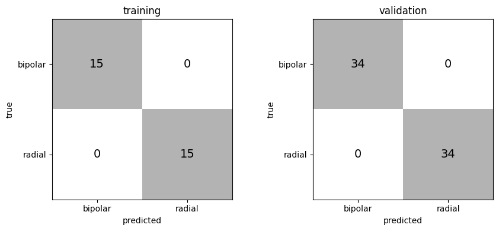</figure>

The learned filter $$\Theta$$ and the activated images $$\mathbf{Z}=h(\mathbf{X}*\Theta+\theta)$$ for nine
validation images.

```python
print("Theta =\n", np.round(cnn[0].weight.detach().numpy()[0, 0], 3))
with torch.no_grad():
    Z = cnn[1](cnn[0](X_t[valid[:9]])).numpy()
fig, axs = plt.subplots(2, 9, figsize=(16, 4))
for k in range(9):
    axs[0, k].imshow(X[valid[k], 0], cmap='gray'); axs[0, k].set_title(classes[y[valid[k]]], fontsize=9)
    axs[1, k].imshow(Z[k, 0], cmap='gray')
for ax in axs.ravel():
    ax.axis('off')
plt.tight_layout()
plt.show()
```

```
Theta =
 [[-0.349 -0.307 -0.742]
 [-0.711 -0.499 -0.039]
 [-0.235  0.313  0.159]]
```

<figure>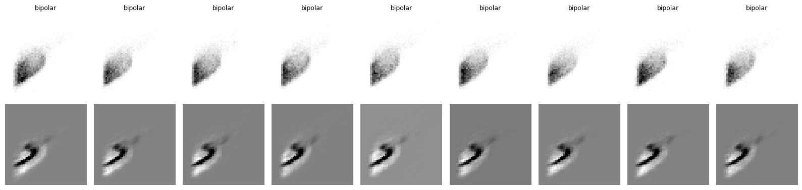</figure>

* Now train CNN to distinguish bacterial species that generate endotoxin.
* Collect 84 obs; 24 for Escherichia Coli (EC), 28 for Pseudomonas Aeruginosa (PA), and 32 for Salmonella Minnesota (SM).
* We use 45 observations for training and 39 for validation.

  <figure>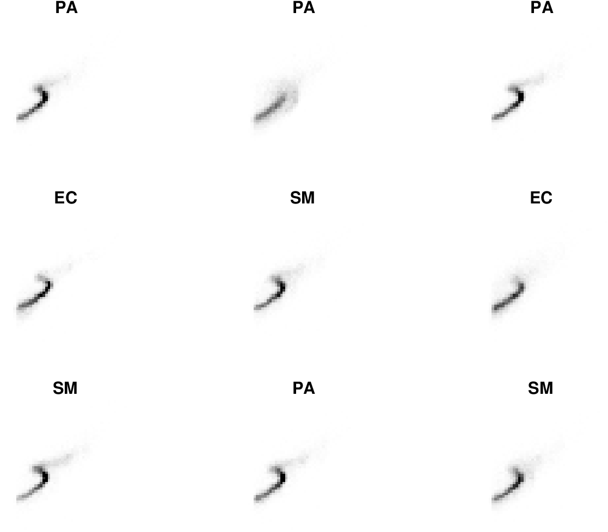<figcaption><p>Example observations for light scatter fields three different bacterial species.</p></figcaption></figure>

<figure>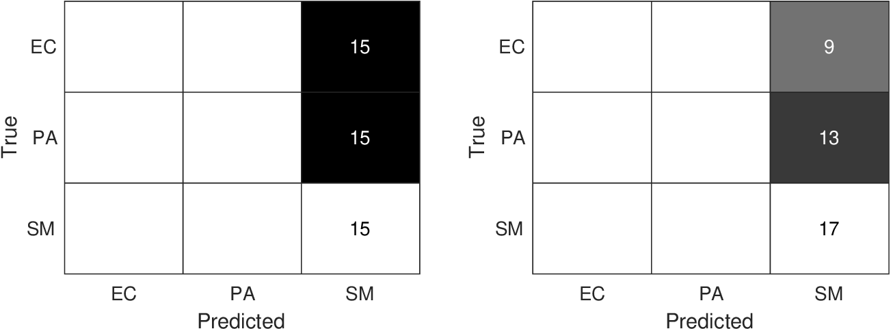<figcaption><p>Confusion matrix for training set (left) and validation set (right) for classification of bacterial species.</p></figcaption></figure>

#### Python implementation


Notebook [`ch6_cnn_endotoxins_caseII.ipynb`](https://colab.research.google.com/github/vzavala/StatsBook-GitBook/blob/main/notebooks/ch6_cnn_endotoxins_caseII.ipynb) — open it in Colab and run the cells alongside this section.


CNN classification of flow-cytometry scatter fields: which bacterial species produced the
endotoxin? (Python version of `ch6_cnn_endotoxins_caseII.m`, Victor Z, UW-Madison, 2020; uses PyTorch.)

| Slides | Python | Meaning |
|---|---|---|
| $$\mathbf{X}_\omega$$ | `X[w, 0]` | $$50\times 50$$ grayscale scatter field |
| $$y_\omega$$ | `y` | class: EC, PA, or SM (*E. coli*, *P. aeruginosa*, *S. minnesota*) |
| $$\Theta^I_j$$, $$\theta^I_j$$ | `cnn[0].weight`, `cnn[0].bias` | two $$3\times 3$$ filters and biases |
| $$\mathbf{A}=\mathbf{X}*\Theta^I+\theta^I$$, $$\mathbf{Z}=h(\mathbf{A})$$ | `cnn[0]`, `cnn[1]` | evidence and ReLU activation |
| $$NN(\mathbf{w},\gamma)$$ | `cnn[3]` | fully connected layer (3 classes, softmax) |
| $$L(\beta)$$ | `loss_fn` | cross-entropy (log) loss |

As in the Matlab script: two $$3\times 3$$ filters with "same" padding, ReLU, a fully connected
layer, 15 training images per class, the rest for validation, SGD with momentum (100 epochs here; the three classes are harder to separate).

```python
import glob
import os
import numpy as np
import matplotlib.pyplot as plt
import torch
import torch.nn as nn
from skimage import io
from sklearn.metrics import confusion_matrix

folder = path + 'Data/Endotoxins_CaseII/Gray'
classes = sorted(os.listdir(folder))
X, y = [], []
for c, name in enumerate(classes):
    for f in sorted(glob.glob(f'{folder}/{name}/*.png')):
        X.append(io.imread(f).astype(np.float32) / 255)
        y.append(c)
X, y = np.array(X)[:, None], np.array(y)
print("classes:", classes, " images per class:", np.bincount(y), " image size:", X.shape[2:])

rng = np.random.default_rng(0)
train = np.concatenate([rng.choice(np.where(y == c)[0], 15, replace=False) for c in range(len(classes))])
valid = np.setdiff1d(np.arange(len(y)), train)
X_t = torch.tensor(X - X[train].mean(axis=0, keepdims=True))      # zero-center (as Matlab's input layer)
y_t = torch.tensor(y)
```

```
classes: ['EC', 'PA', 'SM']  images per class: [24 28 32]  image size: (50, 50)
```

```python
torch.manual_seed(0)
cnn = nn.Sequential(nn.Conv2d(1, 2, kernel_size=3, padding=1),   # A = X * Theta + theta
                    nn.ReLU(),                                     # Z = h(A)
                    nn.Flatten(),                                  # feature vector w
                    nn.Linear(2 * 50 * 50, len(classes)))              # fully connected layer
loss_fn = nn.CrossEntropyLoss()
optimizer = torch.optim.SGD(cnn.parameters(), lr=0.01, momentum=0.9)

history = []
for epoch in range(100):
    perm = torch.tensor(train)[torch.randperm(len(train))]
    for b in range(0, len(perm), 10):
        idx = perm[b:b + 10]
        optimizer.zero_grad()
        loss = loss_fn(cnn(X_t[idx]), y_t[idx])
        loss.backward()
        optimizer.step()
    with torch.no_grad():
        acc = [(cnn(X_t[ids]).argmax(1) == y_t[ids]).float().mean().item() for ids in (train, valid)]
    history.append(acc)

history = np.array(history)
plt.plot(history[:, 0], 'k-', label='training'); plt.plot(history[:, 1], 'k--', label='validation')
plt.xlabel('epoch'); plt.ylabel('accuracy'); plt.legend(); plt.grid(True)
plt.show()
print(f"training accuracy = {history[-1, 0]:.0%},  validation accuracy = {history[-1, 1]:.0%}")
```

<figure>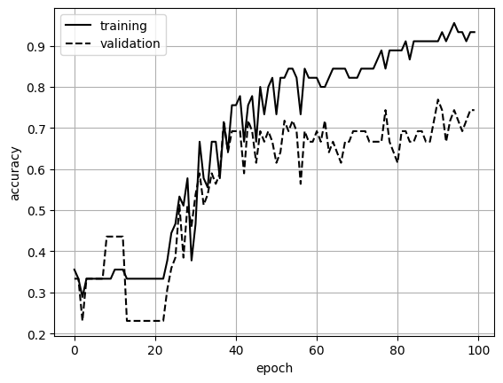</figure>

```
training accuracy = 93%,  validation accuracy = 74%
```

```python
with torch.no_grad():
    y_hat = cnn(X_t).argmax(1).numpy()
fig, axs = plt.subplots(1, 2, figsize=(9, 4))
for ax, ids, title in ((axs[0], train, 'training'), (axs[1], valid, 'validation')):
    cm = confusion_matrix(y[ids], y_hat[ids], labels=range(len(classes)))
    ax.imshow(cm, cmap='Greys', alpha=0.3)
    for (i, j), v in np.ndenumerate(cm):
        ax.text(j, i, v, ha='center', va='center', fontsize=14)
    ax.set_xticks(range(len(classes))); ax.set_xticklabels(classes)
    ax.set_yticks(range(len(classes))); ax.set_yticklabels(classes)
    ax.set_xlabel('predicted'); ax.set_ylabel('true'); ax.set_title(title)
plt.tight_layout()
plt.show()
```

<figure>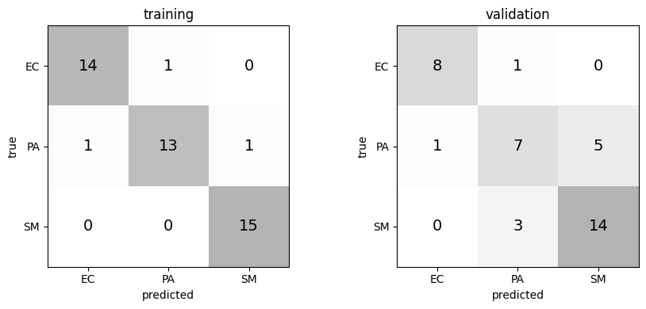</figure>

The learned filters $$\Theta_j$$ and the activated images (first filter) for nine validation images.

```python
for j in range(2):
    print(f"Theta_{j+1} =\n", np.round(cnn[0].weight.detach().numpy()[j, 0], 3))
with torch.no_grad():
    Z = cnn[1](cnn[0](X_t[valid[:9]])).numpy()
fig, axs = plt.subplots(2, 9, figsize=(16, 4))
for k in range(9):
    axs[0, k].imshow(X[valid[k], 0], cmap='gray'); axs[0, k].set_title(classes[y[valid[k]]], fontsize=9)
    axs[1, k].imshow(Z[k, 0], cmap='gray')
for ax in axs.ravel():
    ax.axis('off')
plt.tight_layout()
plt.show()
```

```
Theta_1 =
 [[-0.001  0.179 -0.277]
 [-0.246 -0.131  0.088]
 [-0.007  0.264 -0.03 ]]
Theta_2 =
 [[-0.666 -1.314 -0.837]
 [-1.693 -1.734 -0.832]
 [-0.999 -0.573  0.168]]
```

<figure>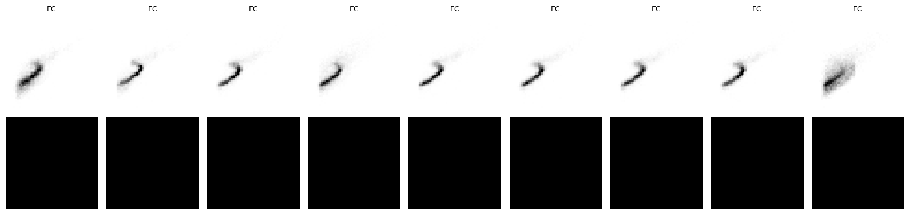</figure>

#### Python implementation


Notebook [`ch6_cnn_sds_caseI.ipynb`](https://colab.research.google.com/github/vzavala/StatsBook-GitBook/blob/main/notebooks/ch6_cnn_sds_caseI.ipynb) — open it in Colab and run the cells alongside this section.


**Additional example: CNN classification of liquid-crystal droplet images (case I).**
Same CNN idea as the endotoxin examples, applied to RGB micrographs of droplets with and without
SDS surfactant (1 mM SDS). The convolutional layer has one $$3\times 3\times 3$$ filter (3 color channels)
followed by ReLU and a fully connected layer. (Shiyi (Amy) Qin and Victor Z, UW-Madison, 2024.)

```python
# Shiyi (Amy) Qin and Victor Z
# UW-Madison, 2024
# use CNN for clasifying LC droplet data (case I)
```

```python
import numpy as np
from scipy.io import loadmat
import random
import torch
import torch.nn as nn
import torch.optim as optim
from torch.utils.data import DataLoader, TensorDataset
from sklearn.model_selection import train_test_split
from sklearn.preprocessing import StandardScaler, LabelEncoder
from sklearn.metrics import confusion_matrix, f1_score, ConfusionMatrixDisplay
import matplotlib.pyplot as plt
```

```python
# Fixing the random seeds for reproducibility
seed = 2024
np.random.seed(seed)
torch.manual_seed(seed)
random.seed(seed)
torch.cuda.manual_seed(seed)
```

```python
# Load IR data from .mat file
x = np.load(path+'Data/lc_img_sds_caseI.npy')
x = x/255. # convert to float and range between 0 and 1
x = np.transpose(x, (0, 3, 1, 2)) # reshape to have channels first to accomodate with dataloader
y = np.load(path+'Data/lc_label_sds_caseI.npy')
print(x.shape, y.shape)
```

```
(100, 3, 256, 256) (100,)
```

```python
# Split the data into training and test sets
x_train, x_valid, y_train, y_valid = train_test_split(x, y, test_size=0.2, stratify=y, random_state=seed, shuffle=True)
```

```python
print(x_train.shape, x_valid.shape)
```

```
(80, 3, 256, 256) (20, 3, 256, 256)
```

```python
# Convert to tensor
x_train = torch.tensor(x_train, dtype=torch.float32)
y_train = torch.tensor(y_train, dtype=torch.long)
x_valid = torch.tensor(x_valid, dtype=torch.float32)
y_valid = torch.tensor(y_valid, dtype=torch.long)

train_dataset = TensorDataset(x_train, y_train)
valid_dataset = TensorDataset(x_valid, y_valid)

train_loader = DataLoader(train_dataset, batch_size=10, shuffle=True)
valid_loader = DataLoader(valid_dataset, batch_size=10, shuffle=False)
```

```python
# define CNN architecture

class SimpleCNN(nn.Module):
    def __init__(self):
        super(SimpleCNN, self).__init__()
        self.conv1 = nn.Conv2d(3, 1, kernel_size=3, padding=1)
        self.relu = nn.ReLU()
        self.fc1 = nn.Linear(256*256*1, 2)  # Assuming input image size is 50x50 and 2 classes

    def forward(self, x):
        x = self.conv1(x)
        x = self.relu(x)
        x = x.view(x.size(0), -1)  # Flatten the tensor
        x = self.fc1(x)
        return x
```

```python
model = SimpleCNN()
```

```python
# Loss and optimizer
criterion = nn.CrossEntropyLoss()
optimizer = optim.Adam(model.parameters(), lr=0.001)
```

```python
# Training the model
num_epochs = 40
train_accuracy_list = []
val_accuracy_list = []

for epoch in range(num_epochs):
    model.train()
    running_loss = 0.0
    correct = 0
    total = 0
    for images, labels in train_loader:
        optimizer.zero_grad()
        outputs = model(images)
        loss = criterion(outputs, labels)
        loss.backward()
        optimizer.step()
        running_loss += loss.item()

        _, predicted = torch.max(outputs.data, 1)
        total += labels.size(0)
        correct += (predicted == labels).sum().item()

    train_accuracy = 100 * correct / total
    train_accuracy_list.append(train_accuracy)

    model.eval()
    correct = 0
    total = 0
    with torch.no_grad():
        for images, labels in valid_loader:
            outputs = model(images)
            _, predicted = torch.max(outputs.data, 1)
            total += labels.size(0)
            correct += (predicted == labels).sum().item()

    val_accuracy = 100 * correct / total
    val_accuracy_list.append(val_accuracy)

    print(f'Epoch [{epoch+1}/{num_epochs}], Loss: {running_loss/len(train_loader):.4f}, Train Accuracy: {train_accuracy:.2f}%, Validation Accuracy: {val_accuracy:.2f}%')
```

```
Epoch [1/40], Loss: 3.1454, Train Accuracy: 51.25%, Validation Accuracy: 85.00%
Epoch [2/40], Loss: 0.8795, Train Accuracy: 70.00%, Validation Accuracy: 80.00%
Epoch [3/40], Loss: 0.3028, Train Accuracy: 86.25%, Validation Accuracy: 100.00%
Epoch [4/40], Loss: 0.1494, Train Accuracy: 93.75%, Validation Accuracy: 80.00%
Epoch [5/40], Loss: 0.1917, Train Accuracy: 92.50%, Validation Accuracy: 100.00%
```

```
Epoch [6/40], Loss: 0.1480, Train Accuracy: 96.25%, Validation Accuracy: 80.00%
Epoch [7/40], Loss: 0.0584, Train Accuracy: 98.75%, Validation Accuracy: 100.00%
Epoch [8/40], Loss: 0.0536, Train Accuracy: 97.50%, Validation Accuracy: 100.00%
Epoch [9/40], Loss: 0.0287, Train Accuracy: 98.75%, Validation Accuracy: 100.00%
Epoch [10/40], Loss: 0.0258, Train Accuracy: 98.75%, Validation Accuracy: 100.00%
```

```
Epoch [11/40], Loss: 0.0229, Train Accuracy: 100.00%, Validation Accuracy: 100.00%
Epoch [12/40], Loss: 0.0180, Train Accuracy: 100.00%, Validation Accuracy: 100.00%
Epoch [13/40], Loss: 0.0170, Train Accuracy: 100.00%, Validation Accuracy: 100.00%
Epoch [14/40], Loss: 0.0098, Train Accuracy: 100.00%, Validation Accuracy: 100.00%
Epoch [15/40], Loss: 0.0075, Train Accuracy: 100.00%, Validation Accuracy: 100.00%
Epoch [16/40], Loss: 0.0063, Train Accuracy: 100.00%, Validation Accuracy: 100.00%
```

```
Epoch [17/40], Loss: 0.0052, Train Accuracy: 100.00%, Validation Accuracy: 100.00%
Epoch [18/40], Loss: 0.0058, Train Accuracy: 100.00%, Validation Accuracy: 100.00%
Epoch [19/40], Loss: 0.0042, Train Accuracy: 100.00%, Validation Accuracy: 100.00%
Epoch [20/40], Loss: 0.0040, Train Accuracy: 100.00%, Validation Accuracy: 100.00%
Epoch [21/40], Loss: 0.0037, Train Accuracy: 100.00%, Validation Accuracy: 100.00%
Epoch [22/40], Loss: 0.0034, Train Accuracy: 100.00%, Validation Accuracy: 100.00%
```

```
Epoch [23/40], Loss: 0.0032, Train Accuracy: 100.00%, Validation Accuracy: 100.00%
Epoch [24/40], Loss: 0.0030, Train Accuracy: 100.00%, Validation Accuracy: 100.00%
Epoch [25/40], Loss: 0.0027, Train Accuracy: 100.00%, Validation Accuracy: 100.00%
Epoch [26/40], Loss: 0.0026, Train Accuracy: 100.00%, Validation Accuracy: 100.00%
Epoch [27/40], Loss: 0.0024, Train Accuracy: 100.00%, Validation Accuracy: 100.00%
Epoch [28/40], Loss: 0.0023, Train Accuracy: 100.00%, Validation Accuracy: 100.00%
```

```
Epoch [29/40], Loss: 0.0022, Train Accuracy: 100.00%, Validation Accuracy: 100.00%
Epoch [30/40], Loss: 0.0021, Train Accuracy: 100.00%, Validation Accuracy: 100.00%
Epoch [31/40], Loss: 0.0019, Train Accuracy: 100.00%, Validation Accuracy: 100.00%
Epoch [32/40], Loss: 0.0020, Train Accuracy: 100.00%, Validation Accuracy: 100.00%
Epoch [33/40], Loss: 0.0017, Train Accuracy: 100.00%, Validation Accuracy: 100.00%
Epoch [34/40], Loss: 0.0017, Train Accuracy: 100.00%, Validation Accuracy: 100.00%
```

```
Epoch [35/40], Loss: 0.0016, Train Accuracy: 100.00%, Validation Accuracy: 100.00%
Epoch [36/40], Loss: 0.0015, Train Accuracy: 100.00%, Validation Accuracy: 100.00%
Epoch [37/40], Loss: 0.0014, Train Accuracy: 100.00%, Validation Accuracy: 100.00%
Epoch [38/40], Loss: 0.0014, Train Accuracy: 100.00%, Validation Accuracy: 100.00%
Epoch [39/40], Loss: 0.0013, Train Accuracy: 100.00%, Validation Accuracy: 100.00%
Epoch [40/40], Loss: 0.0013, Train Accuracy: 100.00%, Validation Accuracy: 100.00%
```

```python
# CNN prediction
model.eval()
all_preds = []
all_labels = []

with torch.no_grad():
    for inputs, labels in train_loader:
        outputs = model(inputs)
        _, predicted = torch.max(outputs, 1)
        all_preds.extend(predicted.numpy())
        all_labels.extend(labels.numpy())

# Confusion matrix
conf_mat_train = confusion_matrix(all_labels, all_preds)
```

```python
# CNN prediction
model.eval()
all_preds = []
all_labels = []

with torch.no_grad():
    for inputs, labels in valid_loader:
        outputs = model(inputs)
        _, predicted = torch.max(outputs, 1)
        all_preds.extend(predicted.numpy())
        all_labels.extend(labels.numpy())

# Confusion matrix
conf_mat_valid = confusion_matrix(all_labels, all_preds)
```

```python
fig, ax = plt.subplots(1, 2, figsize=(8, 4))

class_names = ['no SDS', '1mM SDS']

ConfusionMatrixDisplay(confusion_matrix=conf_mat_train, display_labels=class_names).plot(ax=ax[0], cmap='gray')
ax[0].set_title('Confusion Matrix - Training')
ax[0].set_xlabel('Predicted Label')
ax[0].set_ylabel('True Label')

ConfusionMatrixDisplay(confusion_matrix=conf_mat_valid, display_labels=class_names).plot(ax=ax[1], cmap='gray')
ax[1].set_title('Confusion Matrix - Validation')
ax[1].set_xlabel('Predicted Label')
ax[1].set_ylabel('True Label')

plt.tight_layout()
plt.show()
```

<figure>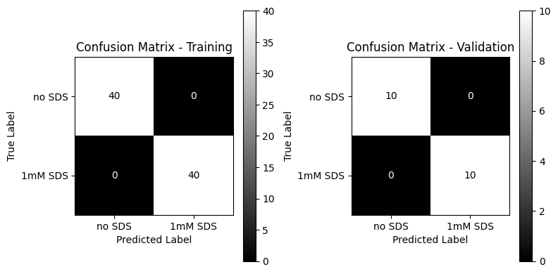</figure>

```python
# Display some images from the validation set
def imshow(img, title):
    img = np.array(img)
    plt.imshow(np.transpose(img, (1, 2, 0)))
    plt.title(title)
    plt.axis('off')

plt.figure(figsize=(7, 7))
val_iter = iter(valid_loader)
images, labels = next(val_iter)
for i in range(9):
    ax = plt.subplot(3, 3, i + 1)
    imshow(images[i], class_names[labels[i]])
plt.tight_layout()
plt.show()
```

<figure>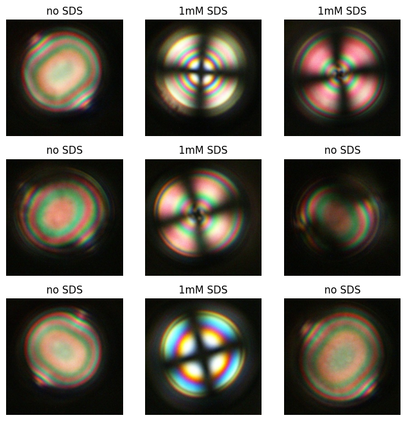</figure>

```python
# Display some images from the validation set
def imshow_gray(img, title, weights=[0.2125, 0.7154, 0.0721]):
    img = np.array(img)
    weights = np.array(weights)
    img_gray = np.dot(np.transpose(img, (1, 2, 0)), weights)
    plt.imshow(img_gray, cmap="gray")
    plt.title(title)
    plt.axis('off')

plt.figure(figsize=(7, 7))
val_iter = iter(valid_loader)
images, labels = next(val_iter)
for i in range(9):
    ax = plt.subplot(3, 3, i + 1)
    imshow_gray(images[i], class_names[labels[i]])
plt.tight_layout()
plt.show()
```

<figure>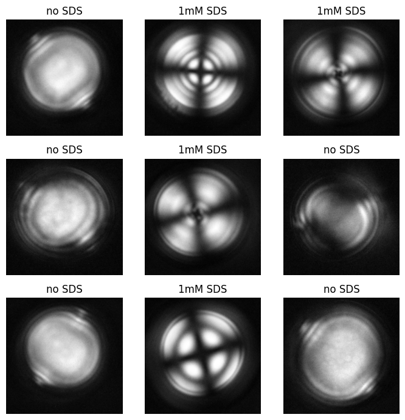</figure>

```python
# Display activations
model.eval()
activations = []
with torch.no_grad():
    for images, _ in valid_loader:
        activations.append(model.conv1(images).detach().numpy())
activations = np.concatenate(activations, axis=0)
```

```python
plt.figure(figsize=(7, 7))
for i in range(9):
    ax = plt.subplot(3, 3, i + 1)
    plt.imshow(activations[i, 0, :, :], cmap='gray')
    plt.title(class_names[labels[i]])
    plt.axis('off')
plt.tight_layout()
plt.show()
```

<figure>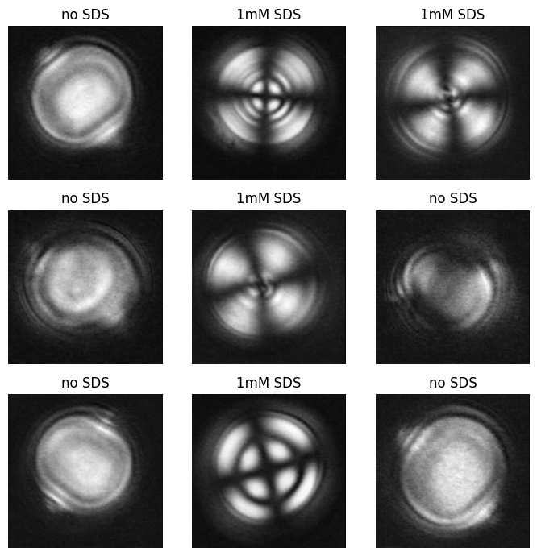</figure>

```python
filter_weight = model.conv1.weight.data.cpu().numpy()[0]
filter_weight
```

```
array([[[ 1.64893754e-02,  1.31883785e-01,  1.88188374e-01],
        [-1.42717153e-01, -1.22254200e-01, -5.17886616e-02],
        [-1.06379457e-01,  4.97205444e-02, -1.40785764e-04]],

       [[ 1.00502454e-01, -1.29175082e-01,  2.89969984e-02],
        [-1.21510148e-01,  8.31167474e-02,  1.68729484e-01],
        [-3.24762166e-02, -7.13730901e-02,  1.60840824e-01]],

       [[ 1.08941570e-01,  5.00245392e-02,  1.58512488e-01],
        [ 1.64571881e-01,  7.09960237e-02,  7.63796046e-02],
        [-9.84024033e-02,  8.19792412e-03, -1.02462113e-01]]],
      dtype=float32)
```

```python
wmin = filter_weight.min()
wmax = filter_weight.max()
```

```python
# Plot the weights of the filters
fig, axes = plt.subplots(1, 3, figsize=(8, 3))

for i in range(3):
    ax = axes[i]
    plot = ax.imshow(filter_weight[i, :, :], cmap='gray', vmin=wmin, vmax=wmax)
    ax.set_title(f'Channel {i+1}', fontsize=12)
    ax.axis('off')
cbar_ax = fig.add_axes([0.92, 0.15, 0.02, 0.7])
fig.colorbar(plot, cax=cbar_ax)
plt.show()
```

<figure>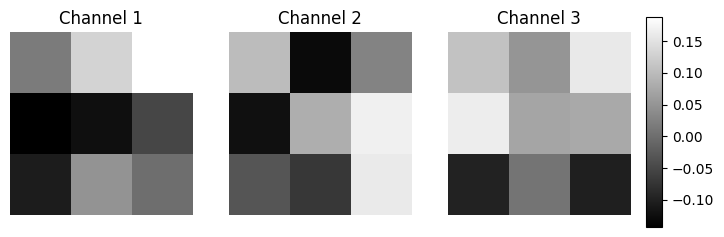</figure>

#### Python implementation


Notebook [`ch6_cnn_sds_caseII.ipynb`](https://colab.research.google.com/github/vzavala/StatsBook-GitBook/blob/main/notebooks/ch6_cnn_sds_caseII.ipynb) — open it in Colab and run the cells alongside this section.


**Additional example: CNN classification of liquid-crystal droplet images (case II).**
Same CNN idea as the endotoxin examples, applied to RGB micrographs of droplets with and without
SDS surfactant (0.05 nM SDS). The convolutional layer has one $$3\times 3\times 3$$ filter (3 color channels)
followed by ReLU and a fully connected layer. (Shiyi (Amy) Qin and Victor Z, UW-Madison, 2024.)

```python
# Shiyi (Amy) Qin and Victor Z
# UW-Madison, 2024
# ch6 use CNN for clasifying LC droplet data (case II)
```

```python
import numpy as np
from scipy.io import loadmat
import random
import torch
import torch.nn as nn
import torch.optim as optim
from torch.utils.data import DataLoader, TensorDataset
from sklearn.model_selection import train_test_split
from sklearn.preprocessing import StandardScaler, LabelEncoder
from sklearn.metrics import confusion_matrix, f1_score, ConfusionMatrixDisplay
import matplotlib.pyplot as plt
```

```python
# Fixing the random seeds for reproducibility
seed = 2024
np.random.seed(seed)
torch.manual_seed(seed)
random.seed(seed)
torch.cuda.manual_seed(seed)
```

```python
# Load IR data from .mat file
x = np.load(path+'Data/lc_img_sds_caseII.npy')
x = x/255. # convert to float and range between 0 and 1
x = np.transpose(x, (0, 3, 1, 2)) # reshape to have channels first to accomodate with dataloader
y = np.load(path+'Data/lc_label_sds_caseII.npy')
print(x.shape, y.shape)
```

```
(100, 3, 256, 256) (100,)
```

```python
# Split the data into training and test sets
x_train, x_valid, y_train, y_valid = train_test_split(x, y, test_size=0.2, stratify=y, random_state=seed, shuffle=True)
```

```python
print(x_train.shape, x_valid.shape)
```

```
(80, 3, 256, 256) (20, 3, 256, 256)
```

```python
# Convert to tensor
x_train = torch.tensor(x_train, dtype=torch.float32)
y_train = torch.tensor(y_train, dtype=torch.long)
x_valid = torch.tensor(x_valid, dtype=torch.float32)
y_valid = torch.tensor(y_valid, dtype=torch.long)

train_dataset = TensorDataset(x_train, y_train)
valid_dataset = TensorDataset(x_valid, y_valid)

train_loader = DataLoader(train_dataset, batch_size=10, shuffle=True)
valid_loader = DataLoader(valid_dataset, batch_size=10, shuffle=False)
```

```python
# define CNN architecture

class SimpleCNN(nn.Module):
    def __init__(self):
        super(SimpleCNN, self).__init__()
        self.conv1 = nn.Conv2d(3, 1, kernel_size=3, padding=1)
        self.relu = nn.ReLU()
        self.fc1 = nn.Linear(256*256*1, 2)  # Assuming input image size is 50x50 and 2 classes

    def forward(self, x):
        x = self.conv1(x)
        x = self.relu(x)
        x = x.view(x.size(0), -1)  # Flatten the tensor
        x = self.fc1(x)
        return x
```

```python
model = SimpleCNN()
```

```python
# Loss and optimizer
criterion = nn.CrossEntropyLoss()
optimizer = optim.Adam(model.parameters(), lr=0.001)
```

```python
# Training the model
num_epochs = 40
train_accuracy_list = []
val_accuracy_list = []

for epoch in range(num_epochs):
    model.train()
    running_loss = 0.0
    correct = 0
    total = 0
    for images, labels in train_loader:
        optimizer.zero_grad()
        outputs = model(images)
        loss = criterion(outputs, labels)
        loss.backward()
        optimizer.step()
        running_loss += loss.item()

        _, predicted = torch.max(outputs.data, 1)
        total += labels.size(0)
        correct += (predicted == labels).sum().item()

    train_accuracy = 100 * correct / total
    train_accuracy_list.append(train_accuracy)

    model.eval()
    correct = 0
    total = 0
    with torch.no_grad():
        for images, labels in valid_loader:
            outputs = model(images)
            _, predicted = torch.max(outputs.data, 1)
            total += labels.size(0)
            correct += (predicted == labels).sum().item()

    val_accuracy = 100 * correct / total
    val_accuracy_list.append(val_accuracy)

    print(f'Epoch [{epoch+1}/{num_epochs}], Loss: {running_loss/len(train_loader):.4f}, Train Accuracy: {train_accuracy:.2f}%, Validation Accuracy: {val_accuracy:.2f}%')
```

```
Epoch [1/40], Loss: 3.4174, Train Accuracy: 46.25%, Validation Accuracy: 65.00%
Epoch [2/40], Loss: 1.0402, Train Accuracy: 57.50%, Validation Accuracy: 50.00%
Epoch [3/40], Loss: 1.0508, Train Accuracy: 43.75%, Validation Accuracy: 60.00%
Epoch [4/40], Loss: 0.7722, Train Accuracy: 52.50%, Validation Accuracy: 70.00%
Epoch [5/40], Loss: 0.5081, Train Accuracy: 70.00%, Validation Accuracy: 65.00%
Epoch [6/40], Loss: 0.4463, Train Accuracy: 78.75%, Validation Accuracy: 85.00%
```

```
Epoch [7/40], Loss: 0.4289, Train Accuracy: 83.75%, Validation Accuracy: 80.00%
Epoch [8/40], Loss: 0.3897, Train Accuracy: 86.25%, Validation Accuracy: 85.00%
Epoch [9/40], Loss: 0.3858, Train Accuracy: 91.25%, Validation Accuracy: 65.00%
Epoch [10/40], Loss: 0.3341, Train Accuracy: 87.50%, Validation Accuracy: 65.00%
Epoch [11/40], Loss: 0.4578, Train Accuracy: 76.25%, Validation Accuracy: 85.00%
Epoch [12/40], Loss: 0.3614, Train Accuracy: 87.50%, Validation Accuracy: 70.00%
```

```
Epoch [13/40], Loss: 0.3069, Train Accuracy: 85.00%, Validation Accuracy: 50.00%
Epoch [14/40], Loss: 0.4344, Train Accuracy: 76.25%, Validation Accuracy: 50.00%
Epoch [15/40], Loss: 0.3015, Train Accuracy: 86.25%, Validation Accuracy: 90.00%
Epoch [16/40], Loss: 0.2287, Train Accuracy: 96.25%, Validation Accuracy: 90.00%
Epoch [17/40], Loss: 0.2038, Train Accuracy: 96.25%, Validation Accuracy: 90.00%
```

```
Epoch [18/40], Loss: 0.1900, Train Accuracy: 97.50%, Validation Accuracy: 80.00%
Epoch [19/40], Loss: 0.1962, Train Accuracy: 96.25%, Validation Accuracy: 80.00%
Epoch [20/40], Loss: 0.1513, Train Accuracy: 100.00%, Validation Accuracy: 75.00%
Epoch [21/40], Loss: 0.1350, Train Accuracy: 98.75%, Validation Accuracy: 85.00%
Epoch [22/40], Loss: 0.1213, Train Accuracy: 100.00%, Validation Accuracy: 95.00%
Epoch [23/40], Loss: 0.1139, Train Accuracy: 100.00%, Validation Accuracy: 95.00%
```

```
Epoch [24/40], Loss: 0.1069, Train Accuracy: 100.00%, Validation Accuracy: 80.00%
Epoch [25/40], Loss: 0.1074, Train Accuracy: 100.00%, Validation Accuracy: 90.00%
Epoch [26/40], Loss: 0.1040, Train Accuracy: 100.00%, Validation Accuracy: 90.00%
Epoch [27/40], Loss: 0.0886, Train Accuracy: 100.00%, Validation Accuracy: 80.00%
Epoch [28/40], Loss: 0.0886, Train Accuracy: 100.00%, Validation Accuracy: 90.00%
Epoch [29/40], Loss: 0.0818, Train Accuracy: 100.00%, Validation Accuracy: 90.00%
```

```
Epoch [30/40], Loss: 0.0825, Train Accuracy: 100.00%, Validation Accuracy: 90.00%
Epoch [31/40], Loss: 0.0849, Train Accuracy: 100.00%, Validation Accuracy: 90.00%
Epoch [32/40], Loss: 0.0620, Train Accuracy: 100.00%, Validation Accuracy: 95.00%
Epoch [33/40], Loss: 0.0602, Train Accuracy: 100.00%, Validation Accuracy: 90.00%
Epoch [34/40], Loss: 0.0589, Train Accuracy: 100.00%, Validation Accuracy: 95.00%
Epoch [35/40], Loss: 0.0535, Train Accuracy: 100.00%, Validation Accuracy: 95.00%
```

```
Epoch [36/40], Loss: 0.0504, Train Accuracy: 100.00%, Validation Accuracy: 95.00%
Epoch [37/40], Loss: 0.0473, Train Accuracy: 100.00%, Validation Accuracy: 95.00%
Epoch [38/40], Loss: 0.0454, Train Accuracy: 100.00%, Validation Accuracy: 90.00%
Epoch [39/40], Loss: 0.0482, Train Accuracy: 100.00%, Validation Accuracy: 100.00%
Epoch [40/40], Loss: 0.0455, Train Accuracy: 100.00%, Validation Accuracy: 80.00%
```

```python
# CNN prediction
model.eval()
all_preds = []
all_labels = []

with torch.no_grad():
    for inputs, labels in train_loader:
        outputs = model(inputs)
        _, predicted = torch.max(outputs, 1)
        all_preds.extend(predicted.numpy())
        all_labels.extend(labels.numpy())

# Confusion matrix
conf_mat_train = confusion_matrix(all_labels, all_preds)
```

```python
# CNN prediction
model.eval()
all_preds = []
all_labels = []

with torch.no_grad():
    for inputs, labels in valid_loader:
        outputs = model(inputs)
        _, predicted = torch.max(outputs, 1)
        all_preds.extend(predicted.numpy())
        all_labels.extend(labels.numpy())

# Confusion matrix
conf_mat_valid = confusion_matrix(all_labels, all_preds)
```

```python
fig, ax = plt.subplots(1, 2, figsize=(8, 4))

class_names = ['no SDS', '0.05nM SDS']

ConfusionMatrixDisplay(confusion_matrix=conf_mat_train, display_labels=class_names).plot(ax=ax[0], cmap='gray')
ax[0].set_title('Confusion Matrix - Training')
ax[0].set_xlabel('Predicted Label')
ax[0].set_ylabel('True Label')

ConfusionMatrixDisplay(confusion_matrix=conf_mat_valid, display_labels=class_names).plot(ax=ax[1], cmap='gray')
ax[1].set_title('Confusion Matrix - Validation')
ax[1].set_xlabel('Predicted Label')
ax[1].set_ylabel('True Label')

plt.tight_layout()
plt.show()
```

<figure>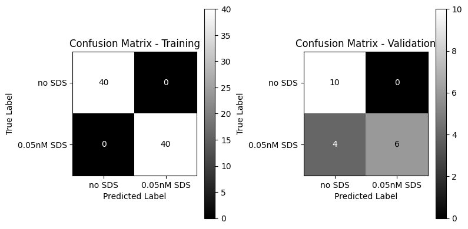</figure>

```python
# Display some images from the validation set
def imshow(img, title):
    npimg = img.numpy()
    plt.imshow(np.transpose(npimg, (1, 2, 0)))
    plt.title(title)
    plt.axis('off')

plt.figure(figsize=(7, 7))
val_iter = iter(valid_loader)
images, labels = next(val_iter)
for i in range(9):
    ax = plt.subplot(3, 3, i + 1)
    imshow(images[i], class_names[labels[i]])
plt.tight_layout()
plt.show()
```

<figure>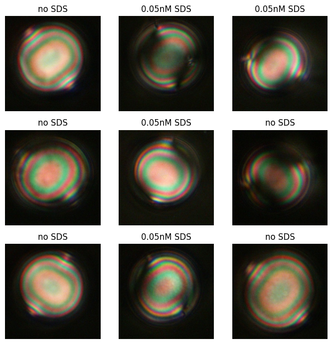</figure>

```python
# Display some images from the validation set
def imshow_gray(img, title, weights=[0.2125, 0.7154, 0.0721]):
    img = np.array(img)
    weights = np.array(weights)
    img_gray = np.dot(np.transpose(img, (1, 2, 0)), weights)
    plt.imshow(img_gray, cmap="gray")
    plt.title(title)
    plt.axis('off')

plt.figure(figsize=(7,7))
val_iter = iter(valid_loader)
images, labels = next(val_iter)
for i in range(9):
    ax = plt.subplot(3, 3, i + 1)
    imshow_gray(images[i], class_names[labels[i]])
plt.tight_layout()
plt.show()
```

<figure>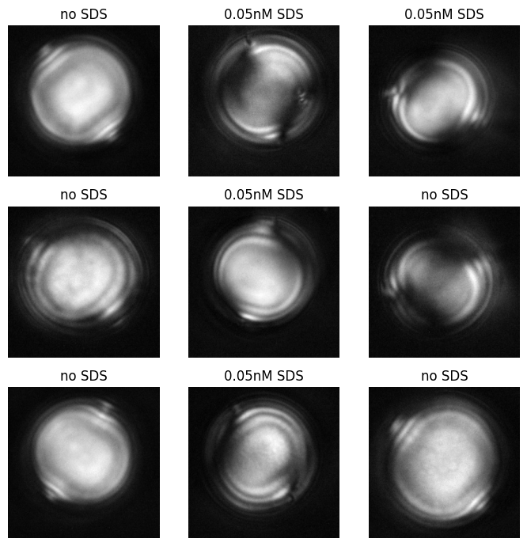</figure>

```python
# Display activations
model.eval()
activations = []
with torch.no_grad():
    for images, _ in valid_loader:
        activations.append(model.conv1(images).detach().numpy())
activations = np.concatenate(activations, axis=0)
```

```python
plt.figure(figsize=(7,7))
for i in range(9):
    ax = plt.subplot(3, 3, i + 1)
    plt.imshow(activations[i, 0, :, :], cmap='gray')
    plt.title(class_names[labels[i]])
    plt.axis('off')
plt.tight_layout()
plt.show()
```

<figure>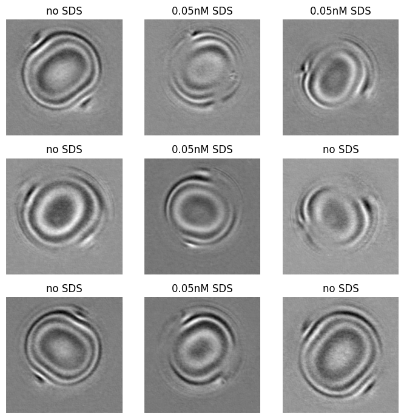</figure>

```python
filter_weight = model.conv1.weight.data.cpu().numpy()[0]
filter_weight
```

```
array([[[-0.01799203,  0.09792089,  0.15351167],
        [-0.17779666, -0.15874638, -0.08697973],
        [-0.14132099,  0.01536683, -0.03535086]],

       [[ 0.0841165 , -0.14572681,  0.01278806],
        [-0.13791113,  0.06674125,  0.15274496],
        [-0.04853722, -0.08729775,  0.14521158]],

       [[ 0.10944358,  0.05032229,  0.15887131],
        [ 0.1647208 ,  0.07114934,  0.07664915],
        [-0.09845033,  0.0082792 , -0.10234494]]], dtype=float32)
```

```python
wmin = filter_weight.min()
wmax = filter_weight.max()
```

```python
# Plot the weights of the filters
fig, axes = plt.subplots(1, 3, figsize=(8, 3))

for i in range(3):
    ax = axes[i]
    plot = ax.imshow(filter_weight[i, :, :], cmap='gray', vmin=wmin, vmax=wmax)
    ax.set_title(f'Channel {i+1}', fontsize=12)
    ax.axis('off')
cbar_ax = fig.add_axes([0.92, 0.15, 0.02, 0.7])
fig.colorbar(plot, cax=cbar_ax)
plt.show()
```

<figure>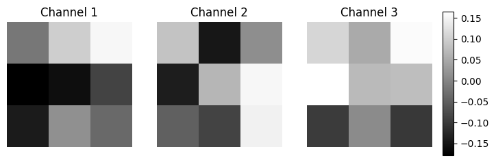</figure>
