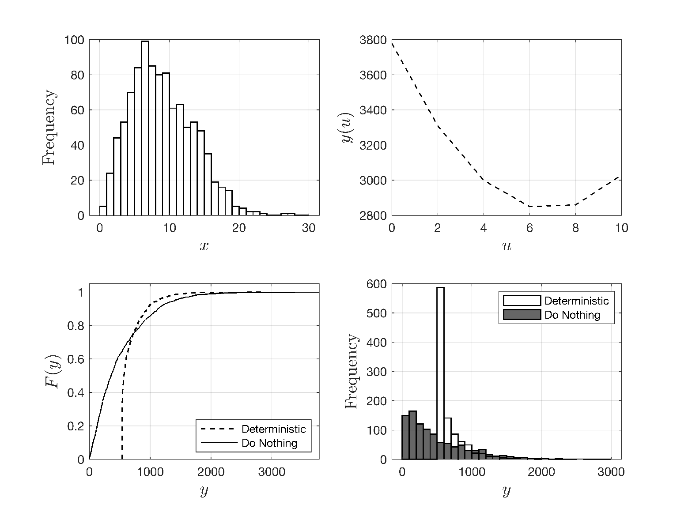
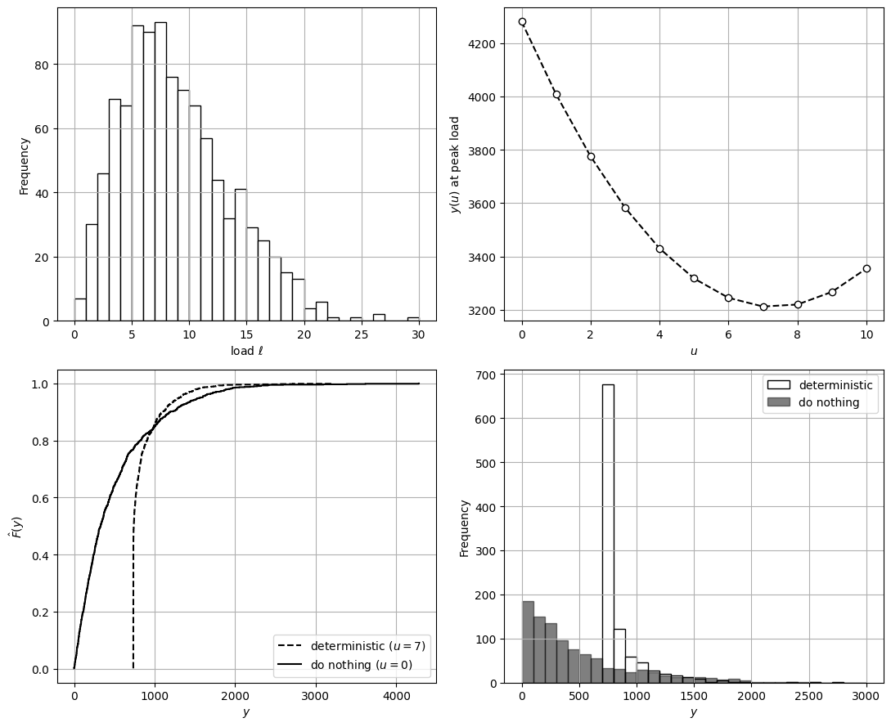

# Deterministic Decision-Making

* Decision-makers (DMs) often make decisions by *ignoring uncertainty*.
* This *deterministic* approach uses following logic.
* Assume $$X$$ takes *representative* value, such as *historical average*:

  $$
  x=\frac{1}{S}\sum_{\omega \in \Omega}x_{\omega}.
  $$

* Input $$X$$ is thus assumed to be deterministic with value $$x$$.
* This implies that $$Y$$ is deterministic with value $$y=\varphi(x,u)$$.
* Want to compare decisions $$u$$ & $$u'$$ with outputs $$y(u)=\varphi(x,u)$$ & $$y(u')=\varphi(x,u')$$.
* If we want to minimize output, we select $$u$$ over $$u'$$ if $$y(u)\leq y(u')$$.
* Comparing decisions *is trivial* in deterministic setting, because we compare *numbers*.

* Consider now that we want to find a decision $$u$$ that minimizes $$\varphi(x,u)$$.
* This is done by solving optimization problem:

  $$
  u_D^*=\mathop{\textrm{argmin}}_{u\in \mathcal{U}}\varphi (x,u)
  $$

* Here, $$\mathcal{U}$$ is set of possible decisions.
* Deterministic DM ignores inherent variability of $$X$$ seen in real-life.
* For instance, “optimal” decision $$u_D^*$$ is only optimal for assumed value $$X=x$$.
* As such, decision might be vulnerable when exposed to other outcomes of $$X$$.
* It is important to evaluate how $$u_D^*$$ behaves when exposed to other outcomes of $$X$$:

  $$
  y_\omega=\varphi(x_\omega,u_D^*),\; \omega \in \mathcal{S}.
  $$

* This provides a complete picture of how *vulnerable (or robust)* is decision $$u_D^*$$.

## Monte Carlo Simulations

* An approach to account for uncertainty in decision-making is to compute decisions for different realizations of $$X$$.
* Consider solution of set of optimization problems:

  $$
  u^*_\omega=\mathop{\textrm{argmin}}_{u\in \mathcal{U}}\varphi (x_\omega,u).
  $$

   for realizations $$x_\omega,\,\omega \in \mathcal{S}$$.

* This computes a decision $$u^*_\omega$$ that is optimal for realization $$x_\omega$$ of $$X$$.
* This approach is known as *sensitivity analysis* or *Monte Carlo analysis* and provides useful insight into how decision changes under possible outcomes of $$X$$.
* However, this approach does not deliver a single (implementable) decision $$u$$ that is optimal *for all outcomes* of $$X$$.

## Example: Deterministic Decision-Making

* Facility wants to purchase on-site generator to mitigate rising electricity costs from the local power grid.
* Power demand/load of facility is random variable $$L$$.
* Capacity of generator is $$u$$ and residual demand is $$R=\max(L-u,0)$$.
* Cost of residual demand purchased from grid is $$\alpha_R\cdot R^2$$.
* Investment cost for generator is $$\alpha_u\cdot u^2$$ and total cost is thus:

  $$
  Y(u)=\alpha_R\cdot R^2 + \alpha_u\cdot u^2.
  $$

* To simplify decision, DM  uses representative value of load $$r=\displaystyle \max_{\omega \in\mathcal{S}}r_\omega$$ (peak).
* Cost in this case is deterministic: $$y(u)=\alpha_R\cdot r^2 + \alpha_u\cdot u^2$$.

* DM has possibility of selecting generators of capacities $$\mathcal{U}=\{0,1,2,....,10\}$$.
* Case for $$u=0$$ is “do-nothing” case (current system) and $$u=10$$ is max capacity.
* Deterministic generator design problem is:

  $$
  \min_{u\in \mathcal{U}}\; \alpha_R\cdot r^2 + \alpha_u\cdot u^2.
  $$

* We can see that cost is minimized with a generator of capacity $$u_D^*=6$$.
* We conduct MC simulations to determine how generator performs under different load outcomes.
* Simulations generate costs $$y_\omega(u)=\alpha_R\cdot r_\omega^2 + \alpha_u\cdot (u_D^*)^2$$ for $$\omega \in \mathcal{S}$$.
* Average cost of new system $$67.4$$ and average cost of current system is $$50.1$$.
* However, new system avoids extreme/peak costs (helps with budgeting).

<figure></figure>

#### Python implementation


Notebook [`ch7_generator_det.ipynb`](https://colab.research.google.com/github/vzavala/StatsBook-GitBook/blob/main/notebooks/ch7_generator_det.ipynb) — open it in Colab and run the cells alongside this section.


Generator sizing: the deterministic decision (Victor Z and David Cole, UW-Madison, 2024).

| Slides | Python | Meaning |
|---|---|---|
| $$L$$, realizations | `L_omega` | random power load (Weibull, scale 10, shape 2) |
| $$u$$, $$\mathcal{U}=\{0,1,\dots,10\}$$ | `u`, `U` | generator capacity and options |
| $$R=\max(L-u,0)$$ | `R` | residual demand bought from the grid |
| $$Y(u)=\alpha_R R^2+\alpha_u u^2$$ | `cost(u, L)` | total cost ($$\alpha_R=5$$, $$\alpha_u=15$$) |
| $$r=\max_\omega r_\omega$$ | `L_peak` | representative (peak) load |
| $$u_D^*$$ | `u_D` | deterministic decision |

```python
import numpy as np
import matplotlib.pyplot as plt
from scipy.stats import weibull_min

alpha_R, alpha_u = 5, 15

def cost(u, L):
    R = np.maximum(L - u, 0)
    return alpha_R * R**2 + alpha_u * u**2

np.random.seed(0)
S = 1000
L_omega = weibull_min.rvs(2, scale=10, size=S)
U = np.arange(0, 11)
```

Deterministic problem with the peak load: $$\min_{u\in\mathcal{U}}\ \alpha_R r^2+\alpha_u u^2$$ with $$r=\max(L_{peak}-u,0)$$.

```python
L_peak = np.max(L_omega)
y_det = np.array([cost(u, L_peak) for u in U])
u_D = U[np.argmin(y_det)]
print(f"peak load = {L_peak:.1f};  deterministic decision u_D* = {u_D}")
```

```
peak load = 29.3;  deterministic decision u_D* = 7
```

Monte Carlo evaluation of $$u_D^*$$ and of the do-nothing option $$u=0$$ under all load outcomes
$$y_\omega(u)=\alpha_R R_\omega^2+\alpha_u u^2$$.

```python
y_D, y_0 = cost(u_D, L_omega), cost(0, L_omega)
print(f"average cost: u_D* -> {y_D.mean():.1f},  do nothing -> {y_0.mean():.1f}")
print(f"maximum cost: u_D* -> {y_D.max():.1f},  do nothing -> {y_0.max():.1f}")

fig, axs = plt.subplots(2, 2, figsize=(11, 9))
axs[0, 0].hist(L_omega, bins=np.arange(0, 31, 1), edgecolor='black', facecolor='white')
axs[0, 0].set_xlabel(r'load $\ell$'); axs[0, 0].set_ylabel('Frequency')
axs[0, 1].plot(U, y_det, 'k--o', markerfacecolor='w')
axs[0, 1].set_xlabel('$u$'); axs[0, 1].set_ylabel('$y(u)$ at peak load')
for y_u, style, label in ((y_D, '--', f'deterministic ($u={u_D}$)'), (y_0, '-', 'do nothing ($u=0$)')):
    axs[1, 0].step(np.sort(y_u), np.arange(1, S + 1) / S, 'k' + style, where='post', label=label)
axs[1, 0].set_xlabel('$y$'); axs[1, 0].set_ylabel(r'$\hat{F}(y)$'); axs[1, 0].legend(loc='lower right')
axs[1, 1].hist(y_D, bins=np.arange(0, 3100, 100), edgecolor='black', facecolor='white', label='deterministic')
axs[1, 1].hist(y_0, bins=np.arange(0, 3100, 100), edgecolor='black', facecolor='black', alpha=0.5, label='do nothing')
axs[1, 1].set_xlabel('$y$'); axs[1, 1].set_ylabel('Frequency'); axs[1, 1].legend()
for ax in axs.ravel():
    ax.grid(True)
plt.tight_layout()
plt.show()
```

```
average cost: u_D* -> 844.6,  do nothing -> 501.8
maximum cost: u_D* -> 3212.4,  do nothing -> 4280.5
```

<figure></figure>
