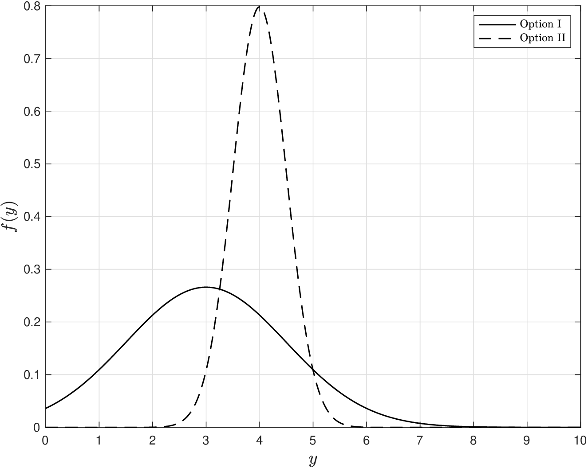
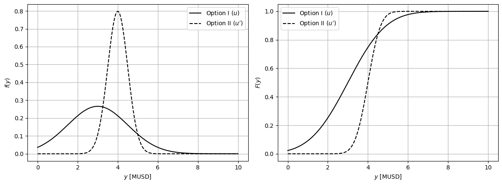
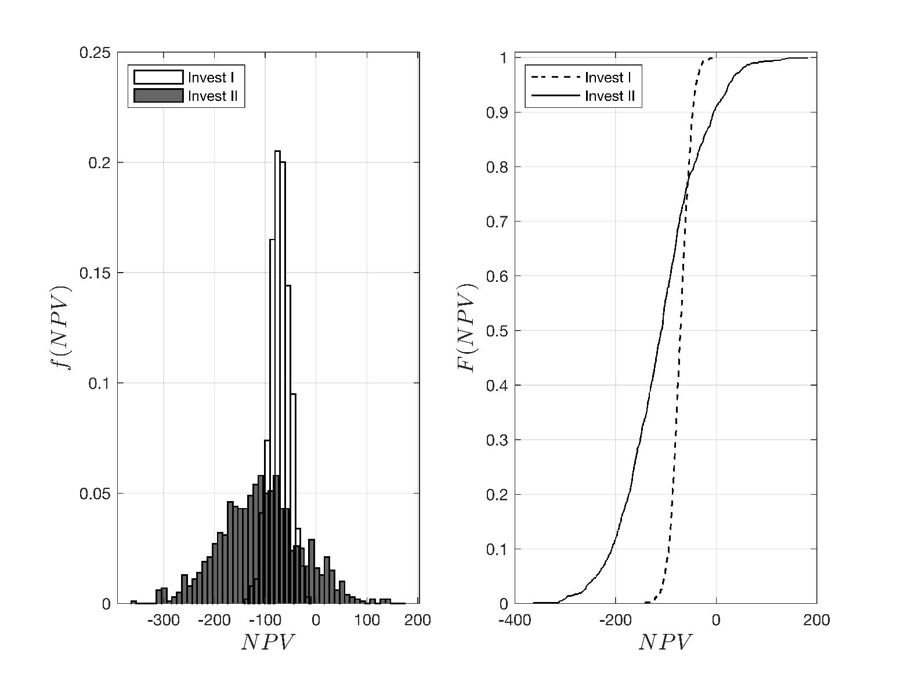
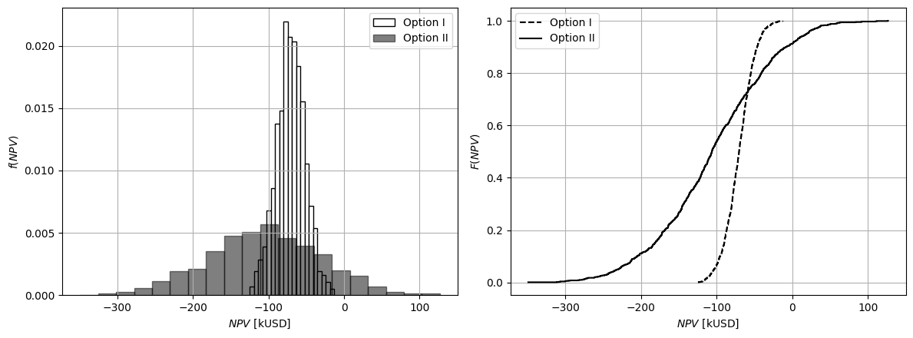

# Attitudes Towards Risk

* Given shortcomings of deterministic approach, we want to make decisions that *explicitly* take uncertainty into account.
* We denote output as $$Y(u)=\varphi(X,u)$$ with pdf $$f_{Y(u)}$$ and cdf $$F_{Y(u)}$$.
* Decision $$u$$ can be used to manipulate pdf/cdf $$Y(u)$$.
* The ability to manipulate pdf/cdf enables mitigation of *risk*.
* Quantifying and mitigating risk is essential.

* Risk is often associated with a decision (e.g., “this is a risky investment”).
* Risk is often associated with extreme events (e.g., bankruptcy or system collapsing).
* There is no *unique* definition of risk.
* Because humans have different perceptions of risk.
* Humans also differ in their risk tolerance (e.g., some DMs love to take risks).
* Perceptions of risk are analogous to perceptions of happiness and fairness.
* Want to investigate what *definitions* of risk exist and what makes a definition *proper*.

## Example: Comparing Random Variables

* Example illustrates how disagreements naturally arise due to different perceptions of risk.
* Have options $$u$$ (Option I) and $$u'$$ (Option II) with random costs $$Y(u)$$ and $$Y(u')$$.
* Option $$u$$ has low mean cost but high var; option $$u'$$ has high mean cost but low var.

Which option is better?

<figure><figcaption><p>Probability and cumulative density functions for cost of competing decisions.</p></figcaption></figure>

* There is no unique answer, “better” depends on how DM attributes value to different aspects of the cost distributions.
* If DM values average cost, $$u$$ is clearly better than $$u'$$, but this choice fails to capture the fact that $$u$$ has a a higher uncertainty and has a higher probability of incurring a large cost. In other words, option $$u$$ is more “risky”.
* If DM values certainty (less “risk”) they will protect themselves against outcomes of high cost. As such, they would prefer $$u'$$ (even if this leads to higher mean cost).
* To formalize comparisons, we need to model the preferences of decision-makers.
* This is done using *risk measures*.

#### Python implementation: Pdfs and cdfs of the two options


Notebook [`ch7_mean_var_comparison.ipynb`](https://colab.research.google.com/github/vzavala/StatsBook-GitBook/blob/main/notebooks/ch7_mean_var_comparison.ipynb) — open it in Colab and run the cells alongside this section.


Comparing two random costs $$Y(u)\sim\mathcal{N}(3,1.5^2)$$ (option I) and $$Y(u')\sim\mathcal{N}(4,0.5^2)$$
(option II), in MUSD (Victor Z and Leo Gonzalez, UW-Madison, 2023).
Python names: `Y_u`, `Y_up` (frozen distributions), `y_bar` (threshold), `alpha`, `VaR`, `CVaR`.

```python
import numpy as np
import matplotlib.pyplot as plt
from scipy.stats import norm

Y_u, Y_up = norm(3, 1.5), norm(4, 0.5)
y = np.linspace(0, 10, 1000)
fig, axs = plt.subplots(1, 2, figsize=(12, 4.5))
for Y, style, label in ((Y_u, 'k-', "Option I ($u$)"), (Y_up, 'k--', "Option II ($u'$)")):
    axs[0].plot(y, Y.pdf(y), style, label=label)
    axs[1].plot(y, Y.cdf(y), style, label=label)
axs[0].set_ylabel('$f(y)$'); axs[1].set_ylabel('$F(y)$')
for ax in axs:
    ax.set_xlabel('$y$ [MUSD]'); ax.grid(True); ax.legend()
plt.tight_layout()
plt.show()
```

<figure></figure>

## Attitudes Towards Risk

The following are typical attitudes towards risk and associated risk measures:

* *Risk-Neutral*: DM prefers $$Y(u)$$ over $$Y(u')$$ if

  $$
  \mathbb{E}_{Y(u)}\leq \mathbb{E}_{Y(u')}
  $$

   DM focuses on average costs and is not concerned about extreme outcomes.

* *Risk-Conscious*: DM prefers $$Y(u)$$ over $$Y(u')$$ if

  $$
  \mathbb{P}(Y(u)\leq \bar{y})\geq \mathbb{P}(Y(u')\leq \bar{y})
  $$

   DM wants a decision that is *more likely* to achieve low outcomes.

* *Risk-Averse*: DM prefers $$Y(u)$$ over $$Y(u')$$ if

  $$
  \max  Y(u)\leq \max Y(u').
  $$

   DM has pessimistic view of uncertainty (because it might lead to large losses).

* *Risk-Taker*: DM prefers $$Y(u)$$ over $$Y(u')$$ if

  $$
  \min Y(u)\leq \min Y(u').
  $$

   DM has optimistic view of uncertainty (because it might lead to gains).

## Example: Attitudes Towards Risk

We revisit cost pdf/cdf of previous example and analyze risk attitudes.

* *Risk-neutral* DM: you select option $$u$$ because this has lower expected cost.
* *Risk-conscious* DM: you select threshold for cost that you are willing to tolerate (e.g., 5 MUSD). You select option $$u'$$ because this has a higher probability of achieving a cost that is below a threshold.
* *Risk-averse* DM: you focus on outcomes of high cost. You select $$u'$$ because this has no outcomes with high cost (e.g., above 6 MUSD). DM focuses on right tail of pdf.
* *Risk-taking* DM: you focus on outcomes of low cost. You select $$u$$ there this has outcomes of low cost (e.g., below 1 MUSD). DM focuses on left tail of pdf. Note that $$u$$ yields outcomes with negative cost (revenue). DM thus exploit risk.

#### Python implementation: Risk attitudes

Risk-neutral: $$\mathbb{E}[Y]$$; risk-conscious: $$\mathbb{P}(Y\leq\bar{y})$$ for $$\bar{y}=5$$;
value-at-risk $$\mathbb{Q}_Y(\alpha)$$ and CVaR $$\mathbb{E}[Y\mid Y\geq\mathbb{Q}_Y(\alpha)]$$ for $$\alpha=0.9$$
(estimated from $$S$$ samples, two ways).

```python
y_bar, alpha = 5, 0.9
np.random.seed(0)
S = 100_000
for name, Y in (("Option I ", Y_u), ("Option II", Y_up)):
    y_omega = Y.rvs(size=S)
    VaR = Y.ppf(alpha)
    CVaR = y_omega[y_omega >= VaR].mean()
    CVaR_alt = VaR + np.mean(np.maximum(y_omega - VaR, 0)) / (1 - alpha)   # Rockafellar-Uryasev form
    print(f"{name}: E = {Y.mean():.2f},  P(Y <= {y_bar}) = {Y.cdf(y_bar):.3f},  "
          f"VaR = {VaR:.2f},  CVaR = {CVaR:.2f} ({CVaR_alt:.2f})")
```

```
Option I : E = 3.00,  P(Y <= 5) = 0.909,  VaR = 4.92,  CVaR = 5.64 (5.63)
Option II: E = 4.00,  P(Y <= 5) = 0.977,  VaR = 4.64,  CVaR = 4.88 (4.88)
```

## Example: Comparing Investment Options

* Have a couple of investment opportunities:
   * Capital $$c_I=\$25,000$$ with annual rate of return $$R_I\sim \mathcal{N}(0.5,0.1)$$.
   * Capital $$c_{II}=\$50,000$$ with annual rate of return $$R_{II}\sim \mathcal{N}(0.4,0.2)$$.
* Net present value for options (10 yr, interest rate of 5%) are:

  $$
  \begin{aligned}
  NPV_I&=c_{I} - R_{I}\cdot c_{I}\cdot \frac{(1-(1+0.05)^{-10})}{i}\\
  NPV_{II}&=c_{II} - R_{II}\cdot c_{II}\cdot \frac{(1-(1+0.05)^{-10})}{i}.
  \end{aligned}
  $$

* Want NPV to be as small as possible (negative values indicate revenue).

<figure><figcaption><p>Density functions for NPVs for competing investment options.</p></figcaption></figure>

* Option I has high mean but is always negative (always makes money and is “safer”).
* Moreover,  Option I has a low variance (low uncertainty).
* Option II has high variance and loses money 10% of time; in some instances it can lose more than $150,000.
* However, with Option II, we make money 90% of the time and it is possible to make a lot of money (at levels that Option I cannot reach).
* If you are risk-averse (do not want to lose money), I seems better.
* If you are a risk-taker (you might be willing to take a chance of losing money some times in exchange of large gains), II is better.

#### Python implementation: Distributions of the NPV


Notebook [`ch7_npv_comparison.ipynb`](https://colab.research.google.com/github/vzavala/StatsBook-GitBook/blob/main/notebooks/ch7_npv_comparison.ipynb) — open it in Colab and run the cells alongside this section.


Comparing investment options through their net present value (Victor Z and Leo Gonzalez, UW-Madison, 2024).

| Slides | Python | Meaning |
|---|---|---|
| $$c_I$$, $$c_{II}$$ | `c_I`, `c_II` | capital [thousand USD] (25 and 50) |
| $$R_I\sim\mathcal{N}(0.5,0.1)$$, $$R_{II}\sim\mathcal{N}(0.4,0.2)$$ | `R_I`, `R_II` | annual rate of return (mean, SD) |
| $$i$$ | `i` | interest rate (5%, 10 years) |
| $$NPV$$, i.e. $$Y(u)$$ and $$Y(u')$$ | `NPV_I`, `NPV_II` | net present value (negative = revenue) |

```python
import numpy as np
import matplotlib.pyplot as plt

np.random.seed(0)
S = 1000
i, years = 0.05, 10
annuity = (1 - (1 + i)**(-years)) / i
c_I, c_II = 25, 50
R_I = np.random.normal(0.5, 0.1, S)
R_II = np.random.normal(0.4, 0.2, S)
NPV_I = c_I - R_I * c_I * annuity
NPV_II = c_II - R_II * c_II * annuity

fig, axs = plt.subplots(1, 2, figsize=(12, 4.5))
axs[0].hist(NPV_I, 20, density=True, color='w', edgecolor='k', label='Option I')
axs[0].hist(NPV_II, 20, density=True, color='k', alpha=0.5, edgecolor='k', label='Option II')
axs[0].set_xlabel('$NPV$ [kUSD]'); axs[0].set_ylabel('$f(NPV)$'); axs[0].legend()
for NPV, style, label in ((NPV_I, 'k--', 'Option I'), (NPV_II, 'k-', 'Option II')):
    axs[1].step(np.sort(NPV), np.arange(1, S + 1) / S, style, where='post', label=label)
axs[1].set_xlabel('$NPV$ [kUSD]'); axs[1].set_ylabel('$F(NPV)$'); axs[1].legend()
for ax in axs:
    ax.grid(True)
plt.tight_layout()
plt.show()
```

<figure></figure>
