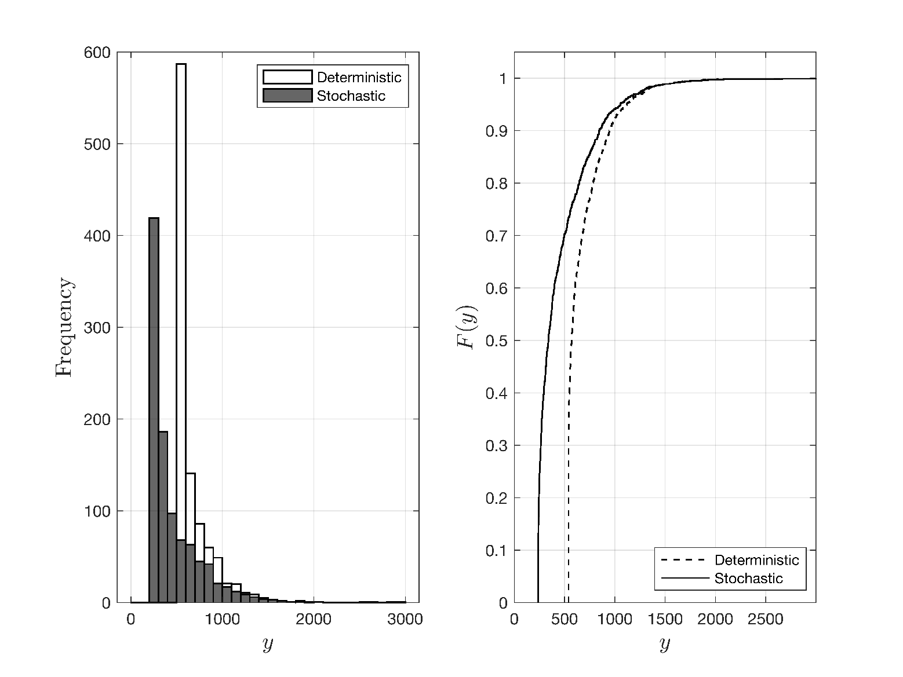
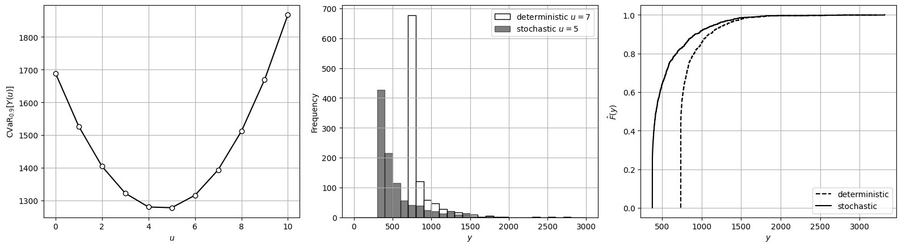
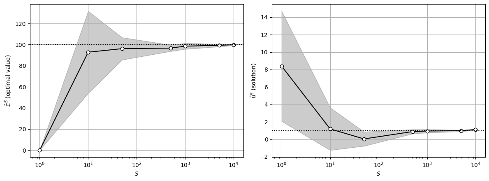

# Stochastic Optimization

* Consider now the situation in which we do not want to compare decisions but we would like to *find best decision* possible.
* We formulate optimization problems that explicitly take uncertainty into account.
* These will use risk measures to optimally shape the distribution of $$Y(u)$$.
* We discuss important notions of *conflict resolution* (trading-off risk measures) and *recourse* (corrective decisions).

## Stochastic Optimization: Basic Formulation

* Ultimate goal is to find decision $$u$$ that optimizes $$Y(u)=\varphi(X,u)$$.
* Complication arises because $$\varphi(X,u)$$ is an RV; as such, problem:

  $$
  u^*=\mathop{\textrm{argmin}}_{u\in \mathcal{U}}\; \varphi(X,u)
  $$

   does not make mathematical sense.

* To formulate problem properly, we optimize a risk measure:
   * Mean-Variance:

     $$
     u^*=\mathop{\textrm{argmin}}_{u\in \mathcal{U}}\; \mathbb{E}[\varphi(X,u)]+ \kappa \mathbb{V}[\varphi(X,u)]
     $$

   * Probability of loss:

     $$
     u^*=\mathop{\textrm{argmin}}_{u\in \mathcal{U}}\; \mathbb{P}(\varphi(X,u)>y)
     $$

   * Expected shortfall:

     $$
     u^*=\mathop{\textrm{argmin}}_{u\in \mathcal{U}}\; \mathbb{E}[\varphi(X,u)\,|\,\varphi(X,u)\geq \mathbb{Q}(\alpha)]
     $$

* Stochastic formulations obtain decisions $$u^*$$ that protect us (hedge) against uncertainty (or exploit uncertainty).
* Type of protection/exploitation depends on risk measure that we use.
* *Ultimate goal* is to manipulate shape of pdf/cdf of $$Y(u)$$.
* Observation is key, because it is quite difficult (if not impossible) to have full control over shape of pdf/cdf.
* For instance, by selecting to minimize a specific aspect of RV (e.g., average), we might need to sacrifice another aspect (e.g., probability of loss or variance).
* This will introduce *conflicting trade-offs*.

## Example: Deterministic vs. Stochastic Decision-Making

* Consider generator sizing problem and assume now that DM would like to size system in a way that it captures uncertainty of demand.
* DM formulates optimization problem that minimizes CVaR of cost (with $$\alpha=0.9$$):

  $$
  \min_{u\in \mathcal{U}}\;  \textrm{CVaR}_\alpha [Y(u)].
  $$

* Stochastic problem selects a generator with capacity of $$u^*=4$$, which is smaller than deterministic $$u_D^*=6$$.

* We compare the pdf/cdf for the deterministic and stochastic design.
* It is clear that stochastic solution reduces overall costs.
* Stochastic solution offers  same level of protection to extreme costs as deterministic.
* This indicates that deterministic solution is *unnecessarily* conservative.

  <figure><figcaption><p>Pdf and Cdf for generator sizing problem using deterministic and stochastic decision-making.</p></figcaption></figure>

#### Python implementation


Notebook [`ch7_generator_stoch.ipynb`](https://colab.research.google.com/github/vzavala/StatsBook-GitBook/blob/main/notebooks/ch7_generator_stoch.ipynb) — open it in Colab and run the cells alongside this section.


Generator sizing: deterministic versus stochastic decision (Victor Z and David Cole, UW-Madison, 2024).
Same model as `ch7_generator_det`; the stochastic decision solves
$$\min_{u\in\mathcal{U}}\ \mathrm{CVaR}_\alpha[Y(u)]$$ with $$\alpha=0.9$$, evaluated with the $$S$$ load samples.
Python names: `rho(u)` (the risk measure), `u_D`, `u_star`; other risk measures are tabulated for comparison.

```python
import numpy as np
import matplotlib.pyplot as plt
from scipy.stats import weibull_min

alpha_R, alpha_u = 5, 15

def cost(u, L):
    R = np.maximum(L - u, 0)
    return alpha_R * R**2 + alpha_u * u**2

np.random.seed(0)
S = 1000
L_omega = weibull_min.rvs(2, scale=10, size=S)
U = np.arange(0, 11)
u_D = U[np.argmin([cost(u, L_omega.max()) for u in U])]

def CVaR(y, alpha=0.9):
    return y[y >= np.quantile(y, alpha)].mean()

rho = {u: CVaR(cost(u, L_omega)) for u in U}
u_star = min(rho, key=rho.get)
print(f"deterministic u_D* = {u_D},  stochastic (CVaR) u* = {u_star}")
print(f"{'u':>3s}{'E':>9s}{'SD':>9s}{'VaR':>9s}{'CVaR':>9s}{'max':>9s}{'P(y>2000)':>11s}")
for u in U:
    y_u = cost(u, L_omega)
    print(f"{u:3d}{y_u.mean():9.1f}{y_u.std():9.1f}{np.quantile(y_u, 0.9):9.1f}{rho[u]:9.1f}"
          f"{y_u.max():9.1f}{np.mean(y_u > 2000):11.1%}")
```

```
deterministic u_D* = 7,  stochastic (CVaR) u* = 5
  u        E       SD      VaR     CVaR      max  P(y>2000)
  0    501.8    514.5   1191.6   1689.2   4280.5       1.5%
  1    433.3    469.7   1057.2   1527.0   4007.9       1.1%
  2    404.8    425.4    962.9   1404.8   3775.3       0.7%
  3    415.8    382.0    908.5   1322.7   3582.7       0.5%
  4    466.0    340.0    894.1   1280.5   3430.1       0.5%
  5    554.7    299.7    919.7   1278.3   3317.6       0.4%
  6    681.2    261.7    985.4   1316.1   3245.0       0.4%
  7    844.6    226.3   1091.0   1394.0   3212.4       0.4%
  8   1044.0    193.8   1236.6   1511.8   3219.8       0.5%
  9   1278.4    164.5   1422.2   1669.6   3267.2       0.9%
 10   1547.2    138.4   1647.8   1867.5   3354.6       1.5%
```

```python
y_D, y_s = cost(u_D, L_omega), cost(u_star, L_omega)
fig, axs = plt.subplots(1, 3, figsize=(16, 4.5))
axs[0].plot(U, [rho[u] for u in U], 'k-o', markerfacecolor='w')
axs[0].set_xlabel('$u$'); axs[0].set_ylabel(r'$\mathrm{CVaR}_{0.9}[Y(u)]$')
axs[1].hist(y_D, bins=np.arange(0, 3100, 100), edgecolor='black', facecolor='white', label=f'deterministic $u={u_D}$')
axs[1].hist(y_s, bins=np.arange(0, 3100, 100), edgecolor='black', facecolor='black', alpha=0.5, label=f'stochastic $u={u_star}$')
axs[1].set_xlabel('$y$'); axs[1].set_ylabel('Frequency'); axs[1].legend()
for y_u, style, label in ((y_D, 'k--', 'deterministic'), (y_s, 'k-', 'stochastic')):
    axs[2].step(np.sort(y_u), np.arange(1, S + 1) / S, style, where='post', label=label)
axs[2].set_xlabel('$y$'); axs[2].set_ylabel(r'$\hat{F}(y)$'); axs[2].legend(loc='lower right')
for ax in axs:
    ax.grid(True)
plt.tight_layout()
plt.show()
```

<figure></figure>

#### Python implementation


Notebook [`ch7_example_SAA.ipynb`](https://colab.research.google.com/github/vzavala/StatsBook-GitBook/blob/main/notebooks/ch7_example_SAA.ipynb) — open it in Colab and run the cells alongside this section.


**Additional example: sample average approximation (SAA)** (Victor Zavala and Leo Gonzalez, UW-Madison, 2024).
Stochastic problems are solved with samples: $$\min_u \hat{\mathbb{E}}^S[\varphi(X,u)]=\frac{1}{S}\sum_\omega\varphi(x_\omega,u)$$.
For $$\varphi(X,u)=(u-X)^2$$ with $$X\sim\mathcal{N}(1,10^2)$$ the exact solution is $$u^*=\mathbb{E}[X]=1$$ with
optimal value $$\mathbb{V}[X]=100$$. Repeating the SAA over $$B$$ batches gives the CLT-based 95% intervals
(Chapter 4) of the optimal value and solution, which shrink as $$S$$ grows.
Python names: `S_values`, `B`, `u_hat` (SAA solutions), `E_hat` (SAA optimal values).

```python
import numpy as np
import matplotlib.pyplot as plt
from scipy.stats import norm

np.random.seed(0)
mu, sigma = 1, 10
B = 10
z = norm.ppf(0.975)
S_values = np.array([1, 10, 50, 500, 1000, 5000, 10000])
u_mean, u_half, E_mean, E_half = [], [], [], []
for S in S_values:
    u_hat, E_hat = np.zeros(B), np.zeros(B)
    for b in range(B):
        x_omega = np.random.normal(mu, sigma, S)
        u_hat[b] = x_omega.mean()                       # argmin of (1/S) sum (u - x_omega)^2
        E_hat[b] = np.mean((u_hat[b] - x_omega)**2)
    u_mean.append(u_hat.mean()); u_half.append(z * u_hat.std(ddof=1) / np.sqrt(B))
    E_mean.append(E_hat.mean()); E_half.append(z * E_hat.std(ddof=1) / np.sqrt(B))
u_mean, u_half, E_mean, E_half = map(np.array, (u_mean, u_half, E_mean, E_half))

fig, axs = plt.subplots(1, 2, figsize=(12, 4.5))
for ax, m, h, ref, label in ((axs[0], E_mean, E_half, sigma**2, r'$\hat{\mathbb{E}}^S$ (optimal value)'),
                             (axs[1], u_mean, u_half, mu, r'$\hat{u}^S$ (solution)')):
    ax.fill_between(S_values, m - h, m + h, color='k', alpha=0.2)
    ax.semilogx(S_values, m, 'k-o', markerfacecolor='w')
    ax.axhline(ref, color='k', ls=':')
    ax.set_xlabel('$S$'); ax.set_ylabel(label); ax.grid(True)
plt.tight_layout()
plt.show()
```

<figure></figure>
