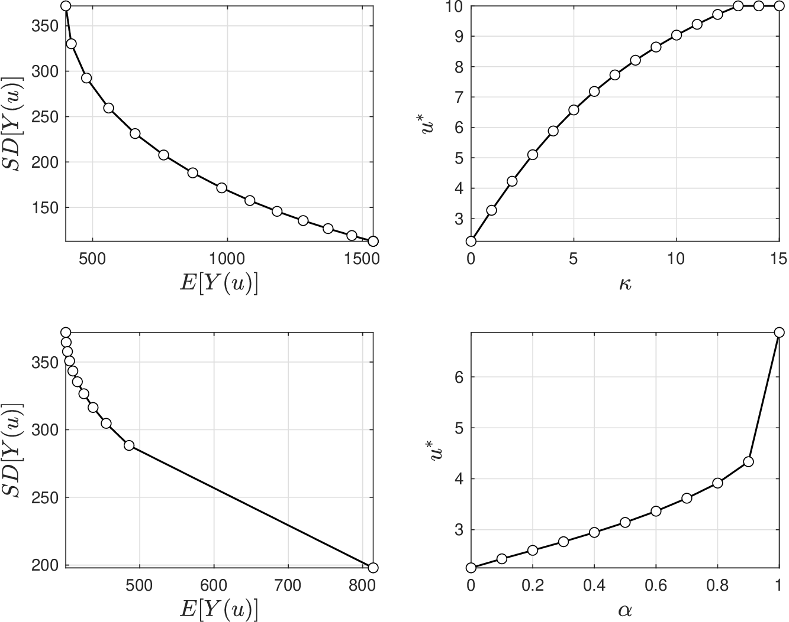
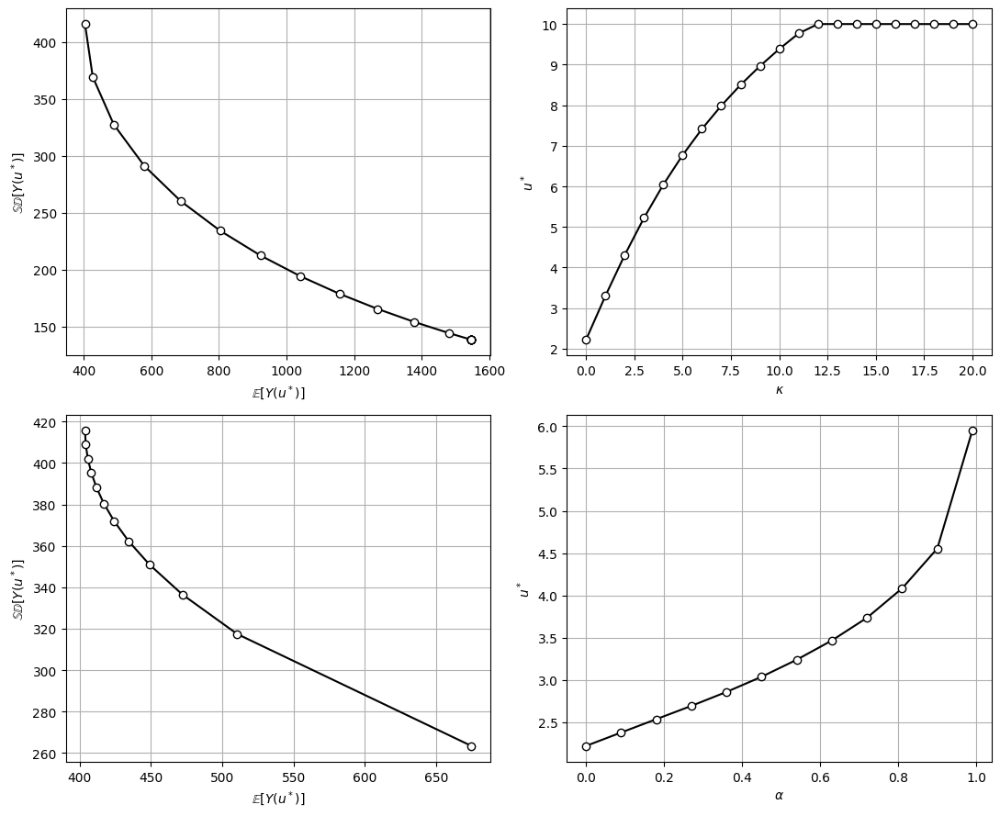

# Conflict Resolution

* To deal with conflicting measures, we can minimize a risk measure, while constraining another.
* This can be formulated as problem:

  $$
  \begin{aligned}
  \mathop{\textrm{min}}_{u\in \mathcal{U}}\;&\;  \rho_o(Y(u))\\
  \textrm{s.t.}\; &\; \rho_c(Y(u))\leq \bar{\rho}
  \end{aligned}
  $$

* Solution of problem for different values of $$\bar{\rho}$$ gives family of optimal solutions that is known as *trade-off (Pareto) frontier.*
* From trade-off frontier, a DM can select a *compromise solution*.
* Can also construct frontier by minimizing weighted sum of risk measures:

  $$
  \begin{aligned}
  \mathop{\textrm{min}}_{u\in \mathcal{U}}\;&\;  \rho_o(Y(u))+\kappa\cdot  \rho_c(Y(u)),
  \end{aligned}
  $$

   where $$\kappa\in \mathbb{R}_+$$ is weighting factor.

## Example: Conflict Resolution in Sizing

* DM is now interested in exploring trade-off between expected cost and variance:

  $$
  \min_{u\in \mathcal{U}}\;  \mathbb{E}[Y(u)] + \kappa \cdot \mathbb{SD}[Y(u)].
  $$

* DM explores trade-off by trying different values of $$\kappa\in [0,20]$$.
* When $$\kappa=0$$, generator is sized to minimize mean cost (while ignoring large costs).
* When $$\kappa$$ is large, generator is sized to try to reduce large costs.
* DM is aware that $$\textrm{CVaR}_{\alpha}[Y(u)]$$ can capture similar behavior (by tuning $$\alpha)$$.
* Specifically, when $$\alpha=0$$, CVaR is $$\mathbb{E}[Y(u)]$$ and, when $$\alpha=1$$, CVaR is $$\max Y(u)$$.
* DM thus solves problem:

  $$
  \min_{u\in \mathcal{U}}\;  \textrm{CVaR}_\alpha [Y(u)]
  $$

   for different values of $$\alpha=[0,1]$$.

* In top-left, can see that there is conflict between mean cost and its variance as we span $$\kappa$$.
* In top-right, we see how optimal capacity increases as we put more emphasis on SD.
* In bottom row we se trade-off curve of mean and SD as we span $$\alpha$$. This has a similar effect as spanning $$\kappa$$.
* This highlights how CVaR can be used to explore trade-offs. However, we notice differences in size of generators.
* Difference is due to asymmetric penalization of CVaR vs. symmetric of SD.

## Example Conflict Resolution in Sizing

<figure></figure>

*Trade-off curve obtained as we span $$\kappa$$ in mean-variance risk measure (top). Trade-off curve obtained as we span $$\alpha$$ in CVaR risk measure (bottom).*

#### Python implementation


Notebook [`ch7_generator_conflict.ipynb`](https://colab.research.google.com/github/vzavala/StatsBook-GitBook/blob/main/notebooks/ch7_generator_conflict.ipynb) — open it in Colab and run the cells alongside this section.


Conflict resolution in generator sizing (Victor Z and David Cole, UW-Madison, 2024). We trace trade-off
curves by solving
$$\min_u\ \mathbb{E}[Y(u)]+\kappa\,\mathbb{SD}[Y(u)]$$ for $$\kappa\in[0,20]$$ and
$$\min_u\ \mathrm{CVaR}_\alpha[Y(u)]$$ for $$\alpha\in[0,1]$$ (here $$u\in[0,10]$$ is treated as continuous).
Python names: `kappa`, `alpha`, `E(u)`, `SD(u)`, `CVaR(u, alpha)`, `u_star`.

```python
import numpy as np
import matplotlib.pyplot as plt
from scipy.optimize import minimize_scalar

alpha_R, alpha_u = 5, 15
np.random.seed(0)
S = 1000
L_omega = np.random.weibull(2, S) * 10

def Y(u):
    return alpha_R * np.maximum(L_omega - u, 0)**2 + alpha_u * u**2

def E(u):
    return Y(u).mean()

def SD(u):
    return Y(u).std()

def CVaR(u, alpha):
    y = Y(u)
    return y[y >= np.quantile(y, alpha)].mean()

def solve(objective):
    return minimize_scalar(objective, bounds=(0, 10), method='bounded').x

kappa = np.arange(0, 21)
u_kappa = np.array([solve(lambda u: E(u) + k * SD(u)) for k in kappa])
alpha = np.linspace(0, 0.99, 12)
u_alpha = np.array([solve(lambda u: CVaR(u, a)) for a in alpha])

fig, axs = plt.subplots(2, 2, figsize=(11, 9))
for row, (u_opt, par, name) in enumerate(((u_kappa, kappa, r'\kappa'), (u_alpha, alpha, r'\alpha'))):
    axs[row, 0].plot([E(u) for u in u_opt], [SD(u) for u in u_opt], 'k-o', markerfacecolor='w')
    axs[row, 0].set_xlabel(r'$\mathbb{E}[Y(u^*)]$'); axs[row, 0].set_ylabel(r'$\mathbb{SD}[Y(u^*)]$')
    axs[row, 1].plot(par, u_opt, 'k-o', markerfacecolor='w')
    axs[row, 1].set_xlabel(f'${name}$'); axs[row, 1].set_ylabel('$u^*$')
for ax in axs.ravel():
    ax.grid(True)
plt.tight_layout()
plt.show()
```

<figure></figure>
