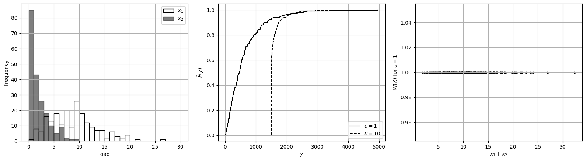

# Formulations with Recourse

## Stochastic Optimization: Formulations with Recourse

* Stochastic formulation finds a decision $$u$$ that protect us against uncertainty.
* This decision is taken in *anticipation* of uncertainty.
* However, in practical situations, we also have ability to protect ourselves by using *corrective actions* that are taken once we face a particular outcome of uncertainty.
* Such corrective actions are known as *recourse of feedback*.
* Consider, *design of a chemical process* in the face of uncertain market conditions.
* The design sets the size and layout of equipment.
* Once process is installed, we can correct how we run the process to respond to market conditions (e.g., by correcting operating conditions).
* *Sequential* decisions capture how humans anticipate & respond to uncertainty.

* Stochastic optimization can capture sequential decisions; consider the system:

  $$
  Y=\varphi(X,u,W(X))
  $$

* Decision $$u$$ is made in anticipation of uncertainty (preemptive).
* Decision $$W(X)$$ is made in response to outcomes of $$X$$ (corrective).
* Note that $$W(X)$$ is an RV (a.k.a. recourse/feedback policy).
* Formulate problem that gives best preemptive $$u$$ and corrective $$W(X)$$ decisions:

  $$
  \begin{aligned}
  \mathop{\textrm{min}}_{u\in \mathcal{U}, W(X)\in \mathcal{W}(u)}\;&\;  \rho_o(\varphi(X,u,W(X))).
  \end{aligned}
  $$

   where $$\mathcal{W}(u)$$ is the set of possible corrective decisions.

* Analogous formulations can be considered that capture risk constraints.
* Optimization formulation is known as two-stage formulation.

## Example: Two-Stage Formulation for Sizing

* Want to size generator to control costs for demands $$X=(X_1,X_2)$$.
* Generator can be operated flexibly; power output $$W(X)$$) satisfies $$W(X)\leq u$$.
* Generator power can be adjusted depending on load conditions $$X$$ observed.
* Amount of residual load requested from power grid is:

  $$
  R=X_1+X_2-W(X)
  $$

   The cost function of system is:

  $$
  Y(u,W(X))=\alpha_R\cdot R^2 + \alpha_u\cdot u^2.
  $$

* Assume we can only select between a couple of capacities $$\mathcal{U}=\{1,10\}$$.
* To prevent power waste, we assume $$0\leq W(X)\leq X_1+X_2$$ and thus:

  $$
  \mathcal{W}(u)=\{0\leq W(X)\leq X_1+X_2,\;W(X)\leq u\}.
  $$

* This set depends on decision $$u$$ and it dictates how flexible the system can be.

* We find optimal sizing by formulating two-stage stochastic problem:

  $$
  \begin{aligned}
  \mathop{\textrm{min}}_{u\in \mathcal{U}, W(X)\in \mathcal{W}(u)}\;&\;  \textrm{CVaR}_{\alpha}\left[Y(u,W(X))\right].
  \end{aligned}
  $$

* Solution of problem yields generator size of $$u^*=1$$.
* Compare against deterministic solution (assume worst-case values of $$X_1,X_2$$):

  $$
  \begin{aligned}
  \mathop{\textrm{min}}_{u\in \mathcal{U}}\;&\;  \alpha_R\cdot r^2 + \alpha_u\cdot u^2\\
  \textrm{s.t.} &\; r=x_1+x_2-w\\
  &\; 0\leq w\leq x_1+x_2\\
  &\; w\leq u.
  \end{aligned}
  $$

* Size that results from this problem is $$u^*_D=10$$ (more conservative).

#### Python implementation


Notebook [`ch7_generator_twostage.ipynb`](https://colab.research.google.com/github/vzavala/StatsBook-GitBook/blob/main/notebooks/ch7_generator_twostage.ipynb) — open it in Colab and run the cells alongside this section.


Two-stage formulation for generator sizing (Victor Z and David Cole, UW-Madison, 2024).

| Slides | Python | Meaning |
|---|---|---|
| $$X=(X_1,X_2)$$ | `X1`, `X2` | two random loads ($$S=200$$ samples) |
| $$u\in\mathcal{U}=\{1,10\}$$ | `u`, `U` | capacity (first stage, preemptive) |
| $$W(X)\in\mathcal{W}(u)$$ | `W` | generator output (second stage, recourse) |
| $$R=X_1+X_2-W(X)$$ | `R` | residual load |
| $$Y(u,W(X))=\alpha_R R^2+\alpha_u u^2$$ | `cost` | cost |

For a given $$u$$ the best recourse in every scenario is $$W(X)=\min(u,\,X_1+X_2)$$: it satisfies
$$0\leq W\leq X_1+X_2$$ and $$W\leq u$$, and it makes $$R$$ (hence each scenario's cost) as small as possible,
so it also minimizes $$\mathrm{CVaR}_\alpha$$.

```python
import numpy as np
import matplotlib.pyplot as plt
from scipy.stats import weibull_min

alpha_R, alpha_u, alpha = 5, 15, 0.9
np.random.seed(0)
S = 200
X1 = weibull_min.rvs(2, scale=10, size=S)
X2 = weibull_min.rvs(1, scale=2, size=S)
U = [1, 10]

def recourse(u, X1, X2):
    return np.minimum(u, X1 + X2)

def cost(u, X1, X2):
    R = X1 + X2 - recourse(u, X1, X2)
    return alpha_R * R**2 + alpha_u * u**2

def CVaR(y):
    return y[y >= np.quantile(y, alpha)].mean()

rho_stoch = {u: CVaR(cost(u, X1, X2)) for u in U}
u_star = min(rho_stoch, key=rho_stoch.get)
rho_det = {u: cost(u, X1.max(), X2.max()) for u in U}      # worst-case loads
u_D = min(rho_det, key=rho_det.get)
print("CVaR of cost:", {u: round(v, 1) for u, v in rho_stoch.items()}, "-> u* =", u_star)
print("deterministic (worst-case) cost:", {u: round(float(v), 1) for u, v in rho_det.items()}, "-> u_D* =", u_D)
```

```
CVaR of cost: {1: np.float64(2056.3), 10: np.float64(2157.6)} -> u* = 1
deterministic (worst-case) cost: {1: 5893.9, 10: 4697.8} -> u_D* = 10
```

```python
fig, axs = plt.subplots(1, 3, figsize=(16, 4.5))
axs[0].hist(X1, bins=np.arange(0, 31, 1), edgecolor='black', facecolor='white', label='$x_1$')
axs[0].hist(X2, bins=np.arange(0, 31, 1), edgecolor='black', facecolor='black', alpha=0.5, label='$x_2$')
axs[0].set_xlabel('load'); axs[0].set_ylabel('Frequency'); axs[0].legend()
for u, style in ((u_star, 'k-'), (u_D, 'k--')):
    y_u = cost(u, X1, X2)
    axs[1].step(np.sort(y_u), np.arange(1, S + 1) / S, style, where='post', label=f'$u={u}$')
axs[1].set_xlabel('$y$'); axs[1].set_ylabel(r'$\hat{F}(y)$'); axs[1].legend(loc='lower right')
axs[2].scatter(X1 + X2, recourse(u_star, X1, X2), s=10, c='k')
axs[2].set_xlabel('$x_1+x_2$'); axs[2].set_ylabel(f'$W(X)$ for $u={u_star}$')
for ax in axs:
    ax.grid(True)
plt.tight_layout()
plt.show()
```

<figure></figure>
