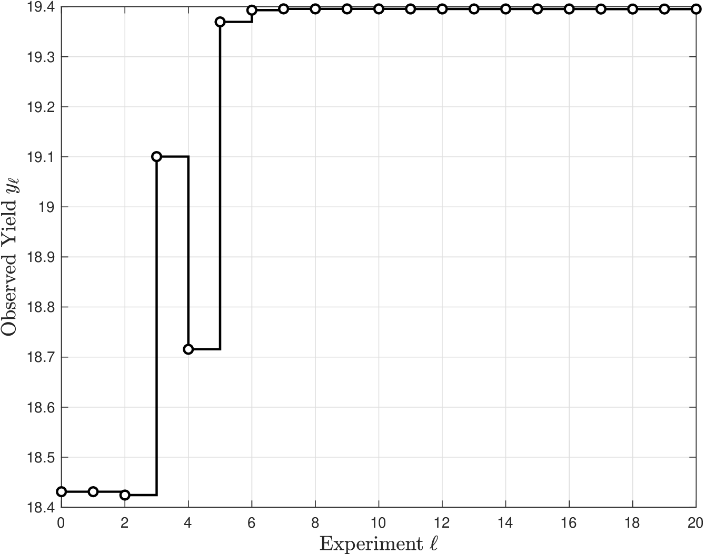
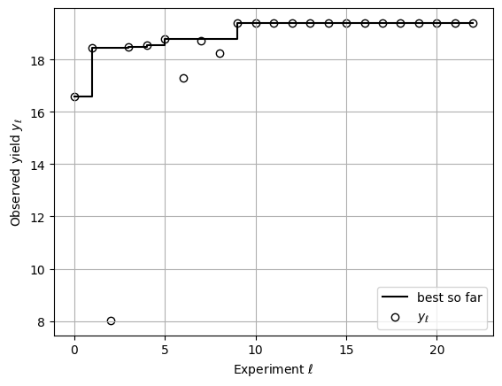

# Bayesian Optimization

* Bayesian Optimization (BO) is a special type of stochastic optimization algorithm.
* BO provides “closed-loop” paradigm that integrates experimental design/data collection, modeling/learning, uncertainty quantification, and decision-making.
* Consider system:

  $$
  Y(u)=\varphi(u)+\epsilon
  $$

* $$\varphi(u)$$ is performance, $$\epsilon$$ is random noise, $$u$$ is decision, and $$Y$$ is observed output.
* Decision $$u$$ represents conditions under which we can run the system (e.g., experimental design).
* Goal of BO is to find conditions $$u$$ that maximize system performance:

  $$
  \max_{u\in \mathcal{U}}\;\; \varphi(u)
  $$

* Challenge is that we *do not know* system function $$\varphi(u)$$ (system is *black box*).
* We need to build a *data-driven* model using data $$(u_\omega,y_\omega),\; \omega\in \mathcal{S}$$.
* This model is known as a *surrogate* model and is used to predict performance.
* Can use diverse models (e.g., linear regression, physics, neural nets, basis).
* Popular modeling approach used in BO is *kriging*, as it captures nonlinear behavior and quantifies uncertainty.

* Imagine we have a kriging model built using data $$(u_\omega,y_\omega),\; \omega\in \mathcal{S}$$.
* Kriging provides mean prediction model $$m_\ell(x)$$ and uncertainty model $$\sigma_\ell(u)$$.
* Define initial dataset as $$\mathcal{D}_\ell$$ and initial model as $$(m_\ell(u),\sigma_\ell(u))$$.
* Here, $$\ell$$ is an iteration counter.
* We can use prediction/uncertainty model for a couple of tasks:
   * Compute decision $$u_{\ell+1}$$ that maximizes the expected performance:

     $$
     \mathop{\max}_{u\in \mathcal{U}}\;m_\ell(u).
     $$

   * Compute decision $$u_{\ell+1}$$ that maximizes information:

     $$
     \mathop{\max}_{u\in \mathcal{U}}\;\sigma_\ell(u).
     $$

* 1st task is *exploitation*, as it exploits knowledge ($$m_\ell(u)$$) to max performance.
* 2nd task is *exploration*, as it explores input space to max info ($$\sigma_\ell(u)$$).

* Select new decision $$u'$$ that balances exploration/exploitation by solving:

  $$
  \max_{u\in \mathcal{U}}\; m_\ell(u) + \kappa \sigma_\ell(u).
  $$

* Objective  is known as the *acquisition function* $$AF_{\ell}(u)=m_\ell(u) + \kappa\cdot \sigma_\ell(x)$$.
* $$\kappa\in \mathbb{R}_+$$ is parameter that balances exploration/exploitation.
* Run experiment $$u'$$ in the system to obtain new data point $$(u',y')$$ and augment dataset $$\mathcal{D}_{\ell+1}\leftarrow \mathcal{D}_\ell\cup (u',y')$$.
* Use new dataset to re-train kriging model $$\mu_{\ell+1}(u),\sigma_{\ell+1}(u)$$ and use this to obtain new input that maximizes $$AF_{\ell+1}(u)$$.
* Loop is repeated over iterations $$\ell,\ell+1,\dots$$ .
* BO selects experiments to progressively improve model and maximize performance.
* BO captures how humans navigate world by collecting data, extract knowledge from data (learn models), and leverage knowledge to make decisions.

## Example: BO for Experimental Design

* A team of scientists want to determine optimal conditions to extract pectin from sunflower heads using oxalic acid as a solvent.
* Need to identify how how pectin yield ($$Y$$) is influenced by $$u_1$$ (extraction temperature), $$u_2$$ (extraction time), and $$u_3$$ (oxalic acid concentration).
* Unfortunately, there is *no physical understanding* of system and yield thus needs to optimized directly using data.
* Apply BO to automatically identify experimental conditions that maximize yield.

* Construct an initial kriging model with 3 experiments.
* Subset of experiments proposed by BO and evolution of yield are shown below.
* BO first runs the 3 inputs at their highest values to reduce uncertainty of model.
* BO then progressively lowers the values of the inputs but eventually realizes that lowering temperature ($$u_1$$) is not a good strategy.
* As such, it decides to increase temperature while, continuing to lowering time ($$u_2$$) and oxalic acid conc ($$u3$$).
* Yield is improved quickly and it eventually saturates, converging to the conditions $$u_1=1$$, $$u_2=0.426$$, and $$u_3=0.24$$.
* BO identifies optimal conditions in less than 30 experiments.

|   |   |   |
|---|---|---|
| 1.0000 | 1.0000 | 1.0000 |
| 1.0000 | 1.0000 | 1.0000 |
| 0.9946 | 0.9946 | 0.9692 |
| 0.8355 | 0.5647 | 0.5133 |
| 0.8697 | 0.7806 | 0.3191 |
| 1.0000 | 0.6770 | 0.2967 |
| ⋮ | ⋮ | ⋮ |
| 1.0000 | 0.4505 | 0.2219 |
| 1.0000 | 0.4426 | 0.2283 |
| 1.0000 | 0.4356 | 0.2338 |
| 1.0000 | 0.4300 | 0.2380 |
| 1.0000 | 0.4259 | 0.2411 |
| 1.0000 | 0.4259 | 0.2411 |

*Subset of experiment history suggested by BO.*

<figure><figcaption><p>Evolution of yield using experiments proposed by BO.</p></figcaption></figure>

#### Python implementation


Notebook [`ch7_bayesopt_yield.ipynb`](https://colab.research.google.com/github/vzavala/StatsBook-GitBook/blob/main/notebooks/ch7_bayesopt_yield.ipynb) — open it in Colab and run the cells alongside this section.


Bayesian optimization of pectin extraction (Victor Z and Leo Gonzalez, UW-Madison, 2024).

| Slides | Python | Meaning |
|---|---|---|
| $$u=(u_1,u_2,u_3)\in[-1,1]^3$$ | `u` | scaled temperature, time, acid concentration |
| $$\varphi(u)$$ | `phi(u)` | yield (a quadratic model plays the "black box") |
| $$\mathcal{D}_\ell$$ | `data_u`, `data_y` | experiments so far |
| $$m_\ell(u)$$, $$\sigma_\ell(u)$$ | `gp.predict(u, return_std=True)` | kriging mean and SD |
| $$AF_\ell(u)=m_\ell(u)+\kappa\sigma_\ell(u)$$ | `AF(u)`, `kappa` | acquisition function ($$\kappa=0.2$$) |

```python
import numpy as np
import matplotlib.pyplot as plt
from sklearn.gaussian_process import GaussianProcessRegressor
from sklearn.gaussian_process.kernels import RBF
from scipy.optimize import minimize, Bounds

b = np.array([16.5780, 3.8563, 0.9250, 0.4212, -1.2840, -0.8515, -1.0940, -0.1425, 0.1900, -0.1675])

def phi(u):
    u = np.atleast_2d(u)
    u1, u2, u3 = u[:, 0], u[:, 1], u[:, 2]
    return (b[0] + b[1]*u1 + b[2]*u2 + b[3]*u3 + b[4]*u1**2 + b[5]*u2**2 + b[6]*u3**2
            + b[7]*u1*u2 + b[8]*u1*u3 + b[9]*u2*u3)
```

Start from 3 experiments and iterate: fit the kriging model, maximize $$AF_\ell(u)$$, run the new
experiment, and add it to the data set.

```python
kappa, n_iter = 0.2, 20
bounds = Bounds(-np.ones(3), np.ones(3))
data_u = np.array([[0, 0, 0], [1, 1, 1], [-1, -1, -1]], dtype=float)
data_y = phi(data_u)
gp = GaussianProcessRegressor(kernel=RBF(length_scale=np.ones(3)), normalize_y=True)

for ell in range(n_iter):
    gp.fit(data_u, data_y)
    def neg_AF(u):
        m, s = gp.predict(np.atleast_2d(u), return_std=True)
        return -(m[0] + kappa * s[0])
    u_new = minimize(neg_AF, data_u[np.argmax(data_y)], method='SLSQP', bounds=bounds).x
    data_u = np.vstack([data_u, u_new])
    data_y = np.append(data_y, phi(u_new))

def descale(u, lb=np.array([70, 1, 0.1]), ub=np.array([100, 2, 0.3])):
    """Map [-1, 1] to temperature [C], time [h], concentration [M]."""
    return lb + (u + 1) / 2 * (ub - lb)

best = np.argmax(data_y)
print("best scaled conditions u =", np.round(data_u[best], 3), "  yield =", round(float(data_y[best]), 3))
print("in physical units:", np.round(descale(data_u[best]), 3))

ell = np.arange(len(data_y))
plt.step(ell, np.maximum.accumulate(data_y), 'k-', where='post', label='best so far')
plt.scatter(ell, data_y, color='w', edgecolor='k', label=r'$y_\ell$')
plt.xlabel(r'Experiment $\ell$'); plt.ylabel(r'Observed yield $y_\ell$')
plt.legend(); plt.grid(True)
plt.show()
```

```
best scaled conditions u = [1.    0.436 0.246]   yield = 19.396
in physical units: [100.      1.718   0.225]
```

<figure></figure>
